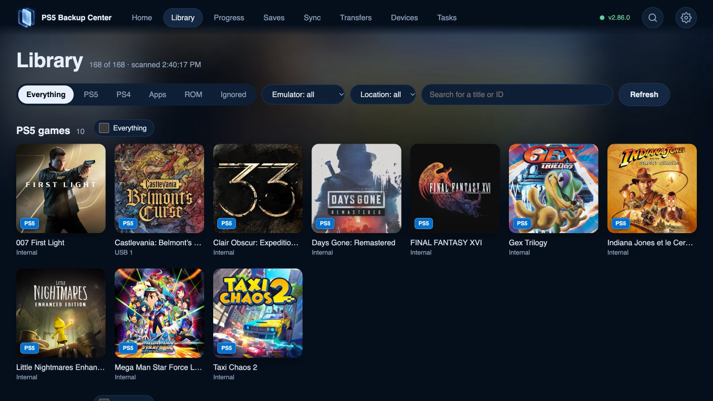

<p align="center">
  
</p>

[English](README.md) · [Français](docs/readme/README.fr.md) · [Français (Canada)](docs/readme/README.fr-CA.md) · [Español](docs/readme/README.es.md) · [Español (Latinoamérica)](docs/readme/README.es-419.md) · [Português (Brasil)](docs/readme/README.pt-BR.md) · [Português (Portugal)](docs/readme/README.pt-PT.md) · [Deutsch](docs/readme/README.de.md) · [Italiano](docs/readme/README.it.md) · [Nederlands](docs/readme/README.nl.md) · [Polski](docs/readme/README.pl.md) · [Türkçe](docs/readme/README.tr.md) · [Русский](docs/readme/README.ru.md) · [简体中文](docs/readme/README.zh-Hans.md) · [繁體中文](docs/readme/README.zh-Hant.md) · [日本語](docs/readme/README.ja.md) · [한국어](docs/readme/README.ko.md) · [Tiếng Việt](docs/readme/README.vi.md) · [العربية](docs/readme/README.ar.md)

<p align="center">
  
</p>

<p><strong>Version 2.98.4</strong> · Browse the library of your other connected PS5 and back up its games and saves from here, on the TV and on the web. Updates are checked and installed by the app itself.</p>

<p align="center">
  <a href="CHANGELOG.md"></a>
  <a href="LICENSE"></a>
  
  
  
  
</p>

<p align="center">
  <b>Back up, compare and restore the saves and games on your PS5 — and the Switch, Switch 2 and emulator saves around it.</b><br>
  One engine on the console, a TV app for the controller, the same interface in any browser. No PC, no extra tool, no extra port.
</p>

<p align="center">
  <a href="docs/guides/01-start.md">Getting started</a> ·
  <a href="docs/media.md">Media</a> ·
  <a href="#install">Install</a> ·
  <a href="#features">Features</a> ·
  <a href="#how-it-works">How it works</a> ·
  <a href="#compatibility">Compatibility</a> ·
  <a href="#roadmap">Roadmap</a> ·
  <a href="#faq">FAQ</a> ·
  <a href="docs/readme/README.fr.md">Français</a>
</p>

---

## Your collection. Your progress. Under your control.

PS5 Backup Center brings games, apps, ROMs and saves together: back up, compare, restore, transfer and synchronise from your TV or browser. Free software, without a subscription.

## Why

A PS5 save lives in one place, on one account, on one console. Emulator saves are scattered across a dozen app folders. Switch saves sit on another device behind JKSV. Most people find out they had no backup the day they need one.

PS5 Backup Center keeps a dated, verified copy of all of it — on a USB drive, on your NAS, or on another console — and lets you bring any version back. It reads what is inside a save, so it can tell you which copies are really different and which are duplicates.

It is part of **[PS5 Center](docs/product-family.md)**, a small family of free, open-source tools built on the same engine.


## Features

<table>
<tr>
<td width="50%" valign="top">

### Saves
- **PS5 saves, account by account** — each game shows *up to date*, *console newer*, *newer in a backup* or *never backed up*.
- **Back up one game or a whole account** in one press; scheduled plans for the rest.
- **Progress you can read** — the text the game writes (mission, %, level, time), plus a catalogue that reads inside saves (ELDEN RING, Expedition 33, Cyberpunk 2077…) and a generic Unreal / JSON reader.
- **Compare by content, not by date** — a fingerprint spots identical copies, progress tells which one goes furthest.
- **Verified restore** — checked first, safety copy, game closed, the right account (re-signed when the ID differs); also straight from the NAS.
- **Switch ↔ PS5** — JKSV saves from a Switch (ftpd) matched to your Eden / ProsperoEden games, profile by profile, both ways.

</td>
<td width="50%" valign="top">

### Backups you can manage
- **Every version, everywhere** — per game, every copy on every disk, the NAS and the other PS5: date, place, size, progress, *protected*.
- **Clean up safely** — duplicates found by content, a cleanup preview, a 30-day trash with *Put back*; hold the button 5 s before anything destructive. Copies of another account are never offered for cleanup.
- **Same PSN account, same backups** — copies made on another console are recognised automatically; old account IDs can be named and resumed on your current account.
- **Full PS5 backup** — accounts, saves, game registrations, homebrews and data, boot settings, captures, each with its size.

</td>
</tr>
<tr>
<td valign="top">

### Two PS5s working together
- **Pair with one 6-digit code** — trust both ways; the other console appears in Devices with its name, IP, system version and disks.
- **Send a save or a whole game** — copied, verified and installed there (ShadowMountPlus), in the format its system can mount (`.ffpfsc`, `.exfat` or as is), save restored on the account you choose.
- **Check before sending** — game version, SDK of its executables, declared minimum system, backport found: a clear warning when the other console is too old.
- **The other PS5's library** — browse its games, apps and saves from here (TV and web), see what is *up to date here / there*, and back up its games and saves remotely.
- **Act on the other console** — open the app there, uninstall a game there (saves backed up first), see the version installed there.
- **Over the Internet too** — an optional encrypted link reaches a PS5 away from home (port 52373, to forward on your router).

</td>
<td valign="top">

### Sync
- **One tab, one card per device** — another PS5, a Switch, the NAS; plans kept ready by the engine, screens fill in at once.
- **Saves** — chosen games keep their copies on both sides; additions only, nothing overwritten.
- **Active progress** — the most recent progress wins and goes to the other console; the one replaced is backed up first; never while the game runs, never in a loop, you decide when both moved.
- **Apps and their settings** — same version on both PS5s, safe replacement with rollback; settings by app profile.
- **DLC and updates** — inventory per game and package library; missing Switch DLC copied between PS5s.
- **The NAS as a depot** — for progress and apps.

</td>
</tr>
<tr>
<td valign="top">

### Games and transfers
- **Transfers tab** — *from* and *to* (this PS5, internal, USB, Switch, NAS, other PS5), then Copy, Move, Compress or Sync.
- **Copy or move a PS5 game** between internal storage and USB: SHA-256 re-read, re-registration; the original is removed only after verification.
- **Image tools** — compress to `.ffpfsc`, decompress, create or extract `.exfat`, verify and repair, read-only flag, speed test, AMPR index. Built on the PS5 Game Compressor code, inside our engine.
- **Files** — copy, move or delete any file or folder between this PS5, USB, the NAS, a Switch and the other PS5; deleting asks for several confirmations.
- **Uninstall a game** — here or on the other PS5; saves are backed up first and the game image is kept by default.
- **Never touches a running game** — and apps keep their execute permissions when they travel.

</td>
<td valign="top">

### Library, devices, interface
- **One library** — PS5 and PS4 games, apps, ROMs from known emulators (plus generic detection), official names and icons, even for games that only exist as a save; each game shows its storage and real disk.
- **Devices** — USB drives, NAS and PCs (**SMB 2/3** shares, FTP, **FTPS** when offered), Switch, other PS5s. Connect, browse, pick the folder, test, save.
- **Home as a notification centre** — what to back up, newer copies, duplicates, sync state, running tasks with time left.
- **TV and web at parity** — phone or computer, paired with a 6-digit code; **19 languages**, 8 themes, sounds.
- **Updates by themselves** — checked automatically from this repository, announced on Home, installed automatically if you want; only changed files, verified, previous version kept for roll-back; also from a USB key, offline.
- **Console power** — restart the PS5 from the app (rest mode is deliberately not offered).

</td>
</tr>
</table>

## Your notification centre, right on Home

Home surfaces games to back up, newer copies, duplicates, comparisons and checks to review, device sync and ongoing tasks. Open a card to inspect the affected content, then follow its result in Tasks. Scroll further for recently played games, saves without an installed game, retro platforms and apps.

[Explore Home and its notifications](docs/guides/17-home-notifications.md).

## Find your way around

- **Home** — Notifications, recently played titles and content available elsewhere.
- **Library** — Games, apps and ROMs; filters, search and item details.
- **Progress** — Active progress on the console, by player.
- **Saves** — Stored copies, versions, comparison and cleanup.
- **Sync** — Save copies, active progress, apps, settings and DLC inventory.
- **Transfers** — Whole games, copy, move and image tools.
- **Devices** — Disks, NAS, Switch and paired PS5 consoles.
- **Tasks** — Queued and running work, reports and plans.
- **Settings** — Languages, themes, sources, users, updates and credits.

[Start with the guides](docs/guides/README.md).

## Screenshots


*Your current game, actions to take and recently played titles.*



*Filter the collection by content, emulator and location in your browser.*

## How it works

```text
       TV app              Browser, port 52370
          │                         │
          ▼                         ▼
┌────────────────────── PS5 ───────────────────────┐
│ Engine (keeps running when the app is closed)    │
│  ├─ Catalogue: games, apps, ROMs, saves          │
│  ├─ Plans, destinations, task journal            │
│  ├─ Copy / restore (one path, verified)          │
│  ├─ Save crypto & mounting (Garlic core)         │
│  ├─ Game images (Game Compressor core)           │
│  └─ Connectors: USB · SMB · FTP · Switch · PS5   │
└─────────┬─────────────────────────┬──────────────┘
          ▼                         ▼
     USB drives            NAS · Switch · PS5
```

- **The engine is the server.** It serves both the API and the web pages on one fixed port on your network (52370). The TV app is just a client, like your browser: closing it stops neither the web UI nor a running backup. The optional Internet link between two PS5s uses its own port (52373), off by default.
- **No external tools.** Save encryption and mounting (from Garlic SaveMgr / garlic-worker) and game image handling (from PS5 Game Compressor) are compiled into the engine. Nothing else to launch, no other port to open.
- **Sources are detected, never hard-coded.** Emulators are described as data; their own config files say where the games are. A newly installed emulator appears at the next scan.
- **Everything leaves a trace on disk.** Tasks and progress are journaled, so an interrupted backup resumes.

## Install

> [!IMPORTANT]
> PS5 Backup Center is homebrew. It needs a PS5 that can already run homebrew apps and payloads. This project does not provide, document or support any way to get there.

### Manual install
1. Download `PPSA99950.zip` from the [latest release](https://github.com/consolecenterstudio/ps5-backup-center/releases/latest) and check its SHA-256 (listed in `SHA256SUMS`).
2. Extract it and copy the `PPSA99950` folder to `/data/homebrew/` on the console (FTP or USB).
3. Launch **PS5 Backup Center** from your homebrew launcher. The app starts its engine on its own. Optional: `ps5-backup-center-<version>-engine.elf`, also in the release, starts the engine alone from an ELF loader (port 9021).

### From ProsperoStore — *submitted soon*
PS5 Backup Center (`PPSA99950`) will be submitted to the community [ps5-homebrew-catalog](https://github.com/darkxex/ps5-homebrew-catalog) used by ProsperoStore, pointing to the same release zip and SHA-256.
4. On a phone or computer on the same network, open `http://<your-ps5-ip>:52370` and enter the 6-digit code shown in **Settings › Devices**.

### Updates
The app checks this repository for new versions by itself and shows a bubble on Home; **Settings › Updates** lists the available versions, can install automatically and can roll back to the previous one. Only changed files are downloaded and verified; the engine and/or the app restart with a countdown. If anything fails, the previous version is put back. Updates also work offline from a USB key. Only versions tested on our own consoles are published here.

## Compatibility

| Area | Status | Notes |
|---|---|---|
| **PS5** | ✅ Available | Requires a compatible native-homebrew environment; compatibility depends on the console, storage format and title. The app never patches the system. |
| PS5 saves | ✅ Available | Backup, verified restore, cross-account restore with confirmation, content comparison. |
| PS5 games (installed, `.ffpfsc`, `.exfat`, folder) | ✅ Available | Copy / move internal ↔ USB, image tools. Running games are never touched. |
| PS4 games and saves on PS5 | ✅ Listed and backed up | PS4 filter in the Library. |
| Full PS5 backup | Backup · Restore planned | Restore and restore-to-another-PS5 are on the roadmap. |
| **Switch** (network) | ✅ Available | ftpd or SMB on the Switch + JKSV backups. Switch ↔ Eden / ProsperoEden sync, profile by profile. |
| **Two PS5s** | ✅ Available | Pairing, remote library, remote backup, game and save transfer; local network or optional Internet link. |
| **SMB** (Windows, Synology, QNAP shares) | ✅ Available | SMB 2/3. Also used to reach a Switch over the network. |
| **Switch 2** (Églantine emulator) | ✅ Available | Its games (.nup / .nsp / .xci) in the Library under *Switch 2*, with covers and saves; settings shared between PS5s. |
| Switch over USB (Hekate UMS) | Planned | Mass-storage mode via Hekate; MTP (haze, DBI) is not readable by the PS5. |
| **NAS / FTP** | ✅ Available | Synology, QNAP, any FTP server. **FTPS** (explicit TLS) when offered; self-signed LAN certificates accepted, fingerprint logged. |
| SFTP · NFS · WebDAV · cloud | 🗓 Planned | SFTP first. |
| USB drives | ✅ Available | Recognised by their witness index, even when they change port. |

### Emulators

Detected from the engine catalogue (`engine/src/scan/emulators_catalog.cpp`) — ROMs, saves, save states and covers, with manual overrides in **Settings › Sources and emulators**. Unknown emulators are detected generically when their folder contains `roms`, `saves`, `states`…

| Emulator | Platform | Emulator | Platform |
|---|---|---|---|
| ProsperoEden / Eden | Switch | Snes9x | Super Nintendo |
| PS5SX2 | PlayStation 2 | Beetle PCE | PC Engine |
| SwanStation | PlayStation | FBNeo | Arcade |
| PSXS5 | PlayStation | Stella | Atari 2600 |
| PSP5 | PSP | PS64 | Commodore 64 |
| Mupen64Plus | Nintendo 64 | PSFlyCast | Dreamcast |
| Genesis Plus GX | Mega Drive / Master System / Game Gear / Mega-CD | Porpoise | GameCube / Wii |
| PS5X360 | Xbox 360 | PS5-ECAM | Wii U · 3DS · DS |
| Églantine | Switch 2 | | |

## Tech stack

| Layer | Technology |
|---|---|
| Engine | C++20, PS5 Payload SDK, LLVM/Clang. Runs as a background payload; HTTP API `/api/v2/…` and static web on port 52370. |
| TV app | C++20 native PS5 app (`PPSA99950`), based on ps5-native-app-boilerplate; own renderer, Inter font. |
| Web UI | Vanilla JavaScript, HTML and CSS — no framework, no build step, served by the engine. |
| Saves | Garlic SaveMgr / garlic-worker core (PS4/PS5 save crypto, mount, re-sign) compiled in. |
| Game images | PS5 Game Compressor core (`.ffpfsc`, `.exfat`, validate / repair) compiled in. |
| Network | BearSSL (HTTPS, FTPS, encrypted PS5 link), own FTP client (MLSD, passive, TLS session resumption), libsmb2 (SMB 2/3). |
| Images | libwebp, stb_image, zlib. |
| Build | Reproducible: two clean builds produce the same engine byte for byte. |

## Roadmap

**In development**: same emulator progress on both PS5s (ProsperoEden, Églantine); installing a game on the other PS5 from its library; Wake-on-LAN.

**Coming next**: SFTP; trash for NAS copies; updating every paired console from one console; PS5 DLC installation; Orbit / PatchDL bridges; organising, compressing, moving and installing games arriving through Orbit or BlackBox; Switch-to-Switch sync; automatic sync; a guided full-backup restore.

**Product family**: PS4 Backup Center and PS5 Center are future projects. PS5 Center aims at broader console, game and cross-device management. PS5 Connector is a future concept for extending capabilities through connectors. Their scope will be described separately.

The 19 languages, eight themes, sounds and music are already part of PS5 Backup Center.

## Credits and licences

PS5 Backup Center is free software under **GPL-3.0-or-later**. It stands on the work of these projects — thank you. The same list is in the app under **Settings › Acknowledgements**.

| Project | Author | Licence | Used for |
|---|---|---|---|
| [ps5-native-app-boilerplate](https://github.com/blackbearreloaded/ps5-native-app-boilerplate) | BlackBearReloaded | GPL-3.0-or-later | Base of the TV app; « Night Drive » music |
| [PS5 Payload SDK](https://github.com/ps5-payload-dev/sdk) | ps5-payload-dev (John Törnblom and contributors) | GPL-3.0 | Libraries, headers and toolchain |
| [SharpProspero](https://github.com/SvenGDK/SharpProspero) | SvenGDK | GPL-3.0 | ELF conversion and app signing |
| [garlic-worker](https://github.com/earthonion/garlic-worker) | earthonion (thanks to c0w-ar, hzhreal, Team-Alua) | GPL-3.0 | PS4/PS5 save encryption, decryption, re-signing |
| [Garlic SaveMgr](https://github.com/earthonion/garlic-savemgr) | earthonion | GPL-3.0 | PS5 save import, mount and export |
| [PS5 Game Compressor](https://github.com/juma-sayeh/PS5-Game-Compressor) | juma-sayeh | GPL-3.0 | Game compression, moves and validation |
| [BearSSL](https://bearssl.org) | Thomas Pornin | MIT | HTTPS and FTPS |
| [libsmb2](https://github.com/sahlberg/libsmb2) | Ronnie Sahlberg and contributors | LGPL-2.1-or-later | SMB 2/3 shares (Windows, Synology, QNAP) |
| [libwebp](https://chromium.googlesource.com/webm/libwebp) | Google | BSD-3-Clause | WebP covers |
| [zlib](https://zlib.net) | Jean-loup Gailly, Mark Adler | zlib | Thumbnail compression |
| [stb_image](https://github.com/nothings/stb) | Sean Barrett | MIT / public domain | Cover decoding |
| [Inter](https://rsms.me/inter) | Rasmus Andersson | SIL OFL 1.1 | Interface font |
| [LLVM / Clang](https://llvm.org) | LLVM Project | Apache-2.0 with LLVM exceptions | Compiler |
| [titledb](https://github.com/blawar/titledb) | blawar and contributors | Public data | Switch game names |
| [PlayStation-Titles](https://github.com/andshrew/PlayStation-Titles) | andshrew | MIT | PS4 / PS5 game names |
| [Prospero Patches](https://prosperopatches.com) / Orbis Patches | prosperopatches.com, orbispatches.com | Public service | Official icons for save-only PS5 / PS4 games |
| tinfoil.media | Tinfoil | Public service | Icons of Switch games not in the library |

**Thanks also to** Elf-Arsenal+ (payload loader), [PS5 Payload Manager](https://github.com/itsPLK/ps5-payload-manager) by itsPLK, [ShadowMount+](https://github.com/drakmor/ShadowMountPlus) by drakmor, Orbit and BlackBox (ergonomics and updates), and Prospero Manager (save and account handling reference).

## Contributing

Bug reports, translations and tested hardware reports are the most useful contributions right now. Read [CONTRIBUTING.md](CONTRIBUTING.md), then open an issue from this repository’s Issues tab. Security problems: see [SECURITY.md](SECURITY.md) — please don't open a public issue.

## FAQ

<details><summary><b>Can it delete or damage my saves or games?</b></summary>

Restores are verified first and make a safety copy of the current save. Deletion always asks for confirmation, never removes a protected version, and *tick duplicates* always keeps one copy of each distinct content. Game moves delete the original only after the copy has been re-read and verified. A running game is never touched.
</details>

<details><summary><b>Do I need a PC or another homebrew tool running?</b></summary>

No. The engine runs on the PS5; the TV app and the web UI talk to it. Garlic and Game Compressor code is built in, so neither needs to be running.
</details>

<details><summary><b>Can I restore a save to a different account or console?</b></summary>

Yes, to another account on the same PS5, with an explicit confirmation. Bringing a full backup to another PS5 is planned.
</details>

<details><summary><b>My NAS already has backups made by a script. Will I lose them?</b></summary>

No. Existing dated folders are read as versions and can be restored. *Move under PBC Backup* only renames folders; when a folder exists on both sides, it merges date by date without overwriting.
</details>

<details><summary><b>Does it read the Switch over USB?</b></summary>

Not yet. Today the Switch is reached over the network (ftpd or SMB, with JKSV). USB via Hekate's mass-storage mode is planned; MTP (haze, DBI) cannot be read by the PS5.
</details>

<details><summary><b>Is it really free?</b></summary>

Yes, and open source (GPL-3.0-or-later). A *buy me a coffee* link will be added for those who want to support the work; nothing is locked behind it.
</details>

## Changelog

Every version and what it brought: [CHANGELOG.md](CHANGELOG.md) — the same history as **Settings › What's new** in the app.

## Support the project

Share a tested hardware report, report a bug, or help improve a translation. See [how to contribute](CONTRIBUTING.md).

---

<p align="center">
  <sub>PS5 Backup Center is an independent community project, not affiliated with or endorsed by Sony Interactive Entertainment or Nintendo.<br>
  “PlayStation”, “PS5”, “PS4” and “Nintendo Switch” are trademarks of their respective owners.</sub>
</p>
