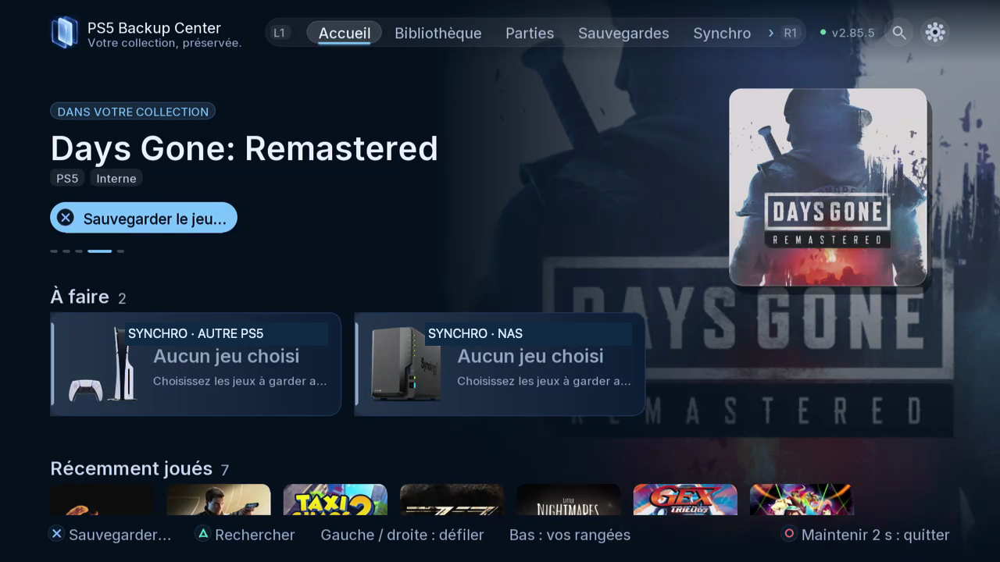
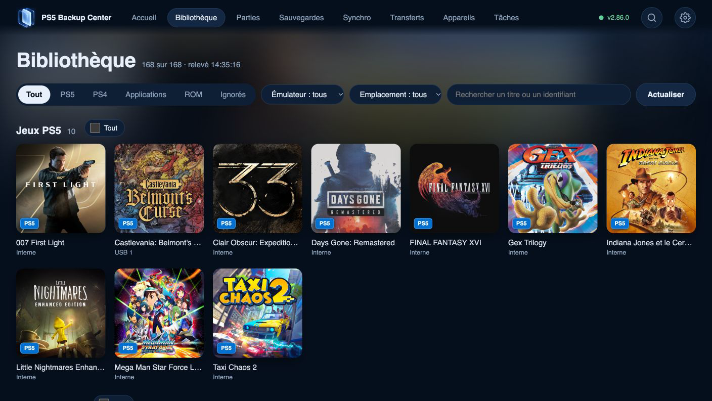

# Bien démarrer

Installer, associer un navigateur et créer une première copie.

## Où le trouver

Télé : Paramètres › Appareils ; Bibliothèque. L1/R1 change les onglets ; ouvrez la roue dentée pour Paramètres.

Web : mêmes espaces dans la navigation du navigateur associé ; utilisez les boutons et cases à cocher.

## Étapes

1. Utilisez une PS5 déjà configurée pour le homebrew natif compatible. Vérifiez le SHA-256 du paquet avec celui de la version avant installation. Les liens publics accompagneront la sortie.
2. Lancez PS5 Backup Center et attendez la connexion au moteur ; continuer sans moteur ne lance pas de sauvegarde.

*L’accueil sépare jeu actuel, actions proposées et jeux récents. Faites défiler pour les autres rangées.*

3. Dans Paramètres › Appareils, relevez l’adresse web affichée. Ouvrez-la sur le réseau local et saisissez le code à six chiffres.

*Dans le navigateur associé, Bibliothèque propose les filtres de contenu, d’émulateur et d’emplacement.*

4. Dans Bibliothèque, ouvrez une fiche, choisissez la partie à sauvegarder et la destination, puis vérifiez le récapitulatif.
5. Consultez le résultat dans Tâches puis la copie datée dans Sauvegardes.

## Précautions

Fermez le jeu ou l’application concernée avant restauration, remplacement ou déplacement. Vérifiez compte, sens et destination ; lisez les confirmations et conservez une copie indépendante des données importantes. Les copies de sécurité et vérifications réduisent les risques sans constituer une garantie absolue.

## Captures à prévoir

pairing, home, first backup summary / association, accueil, récapitulatif

[Inventaire des captures](screenshot-plan.md) · [Index](README.fr-CA.md)

[Utiliser le web et le moteur en arrière-plan](16-web-engine.fr-CA.md)
