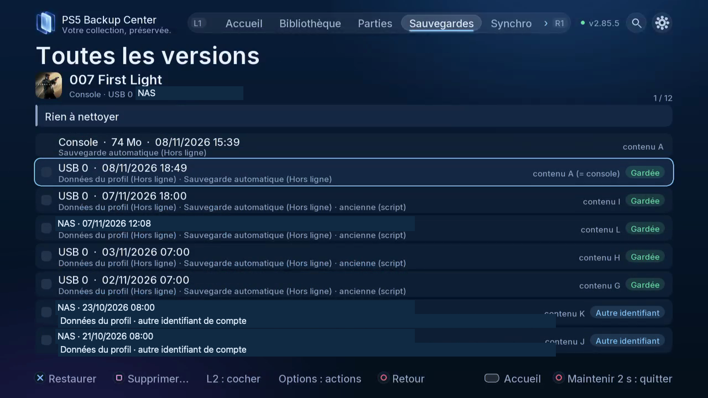

# Sauvegarder et restaurer au quotidien

Retrouver un titre, protéger une partie et reprendre une version choisie.

## Où le trouver

Télé : Accueil / Bibliothèque / Parties / Sauvegardes / Tâches. L1/R1 change les onglets ; ouvrez la roue dentée pour Paramètres.

Web : mêmes espaces dans la navigation du navigateur associé ; utilisez les boutons et cases à cocher.

## Étapes

1. Filtrez Bibliothèque par type, émulateur ou emplacement. Parties contient la partie jouable sur la console ; Sauvegardes contient les copies rangées.
2. Choisissez compte, composants et destination ; vérifiez l’espace puis suivez Tâches.
3. Ouvrez toutes les versions et comparez contenu, progression et temps de jeu. La date seule ne prouve pas une partie plus avancée.

*Le contenu A correspond ici à celui de la console ; les autres lettres distinguent les contenus rangés. Regardez les protections avant nettoyage.*

4. Pour restaurer, fermez le jeu, choisissez version et compte destinataire, lisez la vérification et la copie de sécurité, puis confirmez.
5. Avant nettoyage, examinez la sélection ; conservez les copies protégées et celles des autres utilisateurs. La suppression demande un maintien de cinq secondes. Vérifiez la corbeille.
6. Pour un plan, choisissez jeux ou règles, composants, destination, horaires et rotation. Enregistrez puis consultez Tâches.

## Précautions

Fermez le jeu ou l’application concernée avant restauration, remplacement ou déplacement. Vérifiez compte, sens et destination ; lisez les confirmations et conservez une copie indépendante des données importantes. Les copies de sécurité et vérifications réduisent les risques sans constituer une garantie absolue.

## Captures à prévoir

version comparison, restore preview, cleanup preview, plan editor / comparaison, restauration, nettoyage, plan

[Inventaire des captures](screenshot-plan.md) · [Index](README.fr-CA.md)

## Aller plus loin

- [Créer et vérifier une sauvegarde](10-first-backup.fr-CA.md)
- [Comparer les copies et nettoyer les doublons](11-compare-cleanup.fr-CA.md)
- [Restaurer une partie choisie](12-restore.fr-CA.md)

[Programmer un plan de sauvegarde](15-plans.fr-CA.md)
