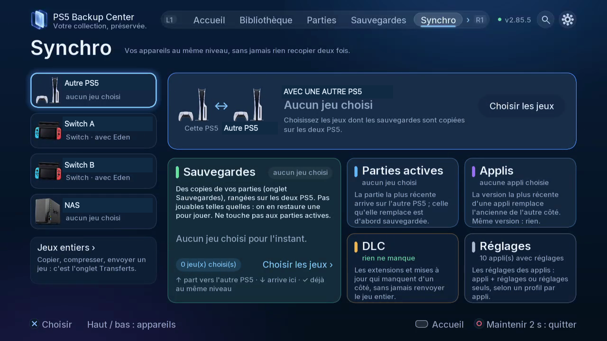

# Destinations et consoles associées

Choisir un stockage et associer une autre console ou une Switch.

## Où le trouver

Télé : Appareils ; Synchro. L1/R1 change les onglets ; ouvrez la roue dentée pour Paramètres.

Web : mêmes espaces dans la navigation du navigateur associé ; utilisez les boutons et cases à cocher.

## Étapes

1. Pour USB, vérifiez l’identité du disque et son espace libre ; ne supposez pas que son numéro de port reste stable.
2. Ajoutez le NAS, choisissez le protocole pris en charge, renseignez la connexion, testez puis sélectionnez le dossier avant enregistrement. FTP / FTPS, SMB et WebDAV sont pris en charge. « Utilisé pour » choisit si le NAS sert aux sauvegardes, à la synchro, ou aux deux.
   Pour le nuage, ouvrez Appareils › Nuage : choisissez un service S3 (Amazon S3, Backblaze B2, Wasabi, Cloudflare R2, Scaleway, OVHcloud, Synology C2…) et saisissez ses clés — le code QR ouvre le même formulaire sur votre téléphone pour les coller — ou pCloud, Koofr, Nextcloud avec votre compte. Google Drive, OneDrive et Dropbox se connectent avec votre propre compte depuis votre téléphone (activation dans une prochaine mise à jour).
3. Sur les deux PS5, ouvrez Appareils, choisissez la console découverte ou son adresse puis validez le code. Vérifiez console et disque destinataires avant envoi.
4. Pour la Switch, démarrez ftpd et préparez un export JKSV. Associez jeu et profil Eden / ProsperoEden. Au retour, suivez les étapes d’import JKSV.
5. Dans Synchro, choisissez l’appareil puis Sauvegardes, Parties actives, Applis, DLC ou Réglages. Vérifiez le sens et les conflits. Jeux entiers ouvre Transferts. Le dépôt NAS concerne parties actives et applis ; DLC et réglages restent entre PS5.

*Choisissez l’appareil à gauche, puis la section. Sauvegardes désigne les copies rangées ; Parties actives, la partie utilisée pour jouer. Jeux entiers ouvre Transferts.*

## Précautions

Fermez le jeu ou l’application concernée avant restauration, remplacement ou déplacement. Vérifiez compte, sens et destination ; lisez les confirmations et conservez une copie indépendante des données importantes. Les copies de sécurité et vérifications réduisent les risques sans constituer une garantie absolue.

## Captures à prévoir

device setup, paired consoles, each Sync section / connexion, association, sections Synchro

[Inventaire des captures](screenshot-plan.md) · [Index](README.fr-CA.md)

## Aller plus loin

- [Choisir le bon parcours de synchronisation](13-sync.fr-CA.md)
