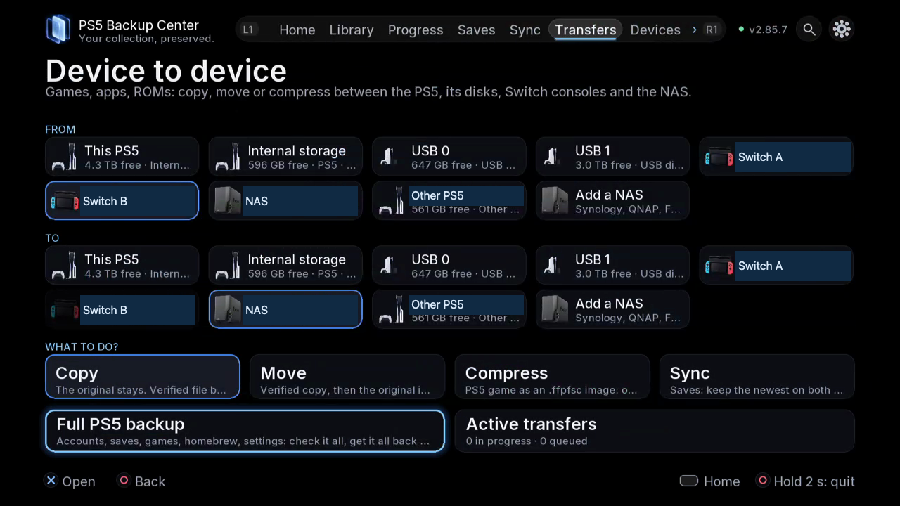

# Games and transfers

Copy, move and manage whole games and game images.

## Where to find it

TV: Transfers; Library › item details. Use L1/R1 for tabs; open the gear for Settings.

Web: the corresponding spaces in the paired browser navigation; use buttons and checkboxes.

## Steps

1. Choose FROM and TO, then the titles. Confirm the actual disk, available space and target compatibility.

*Read FROM and TO before choosing Copy, Move or Compress. The selected source and target are highlighted separately.*

2. Choose Copy to retain the source or Move to remove it only after verification. Review the format: folder, .exfat or compressed .ffpfsc.
3. Open the image tools for compression, extraction, verification or a read speed test. Read each tool’s explanation before accepting writes.
4. When sending to another PS5, review system / SDK / backport evidence and receiving account. A compatibility indication is not a guarantee that a game will run.
5. For a full PS5 backup, select the categories and destination, review sizes and follow Tasks. A full-backup restore wizard is a separate future capability.

## Safety and attention

Close the affected game or app before restoring, replacing or moving it. Check account, direction and destination; read confirmations and keep an independent copy of important data. Verification and safety copies reduce risk without providing an absolute guarantee.

## Screenshots to prepare

transfer summary, compatibility, image tools, full-backup checklist / transfert, compatibilité, outils, sauvegarde complète

[Screenshot inventory](screenshot-plan.md) · [Guide index](README.md)

## Detailed instructions

- [Copy or move a whole game](14-transfer-workflow.md)
