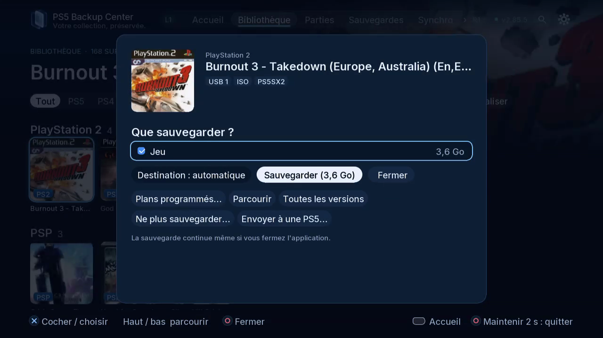

# Émulateurs et ROMs

Distinguer ROMs, configurations, parties et états.

## Où le trouver

Télé : Paramètres › Sources et émulateurs ; Bibliothèque. L1/R1 change les onglets ; ouvrez la roue dentée pour Paramètres.

Web : mêmes espaces dans la navigation du navigateur associé ; utilisez les boutons et cases à cocher.

## Étapes

1. Examinez les sources détectées ; les composants disponibles dépendent de l’émulateur installé.
2. Vérifiez dossiers de ROMs, configuration et parties ; utilisez le navigateur. Le retour automatique rétablit la détection.
3. Filtrez Bibliothèque par émulateur, ouvrez la ROM et choisissez les composants proposés : ROM, partie, état ou configuration.

*Cette fiche ROM propose uniquement le jeu. Les composants dépendent de l’émulateur et des fichiers détectés ; une partie ou un état ne sont pas implicites.*

4. Pour Switch, vérifiez le profil Eden / ProsperoEden destinataire puis consultez Tâches.

## Précautions

Fermez le jeu ou l’application concernée avant restauration, remplacement ou déplacement. Vérifiez compte, sens et destination ; lisez les confirmations et conservez une copie indépendante des données importantes. Les copies de sécurité et vérifications réduisent les risques sans constituer une garantie absolue.

## Captures à prévoir

source editor, ROM details, profile choice / source, fiche ROM, profil

[Inventaire des captures](screenshot-plan.md) · [Index](README.fr-CA.md)
