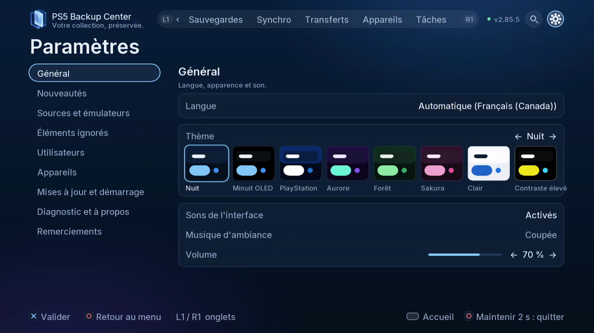
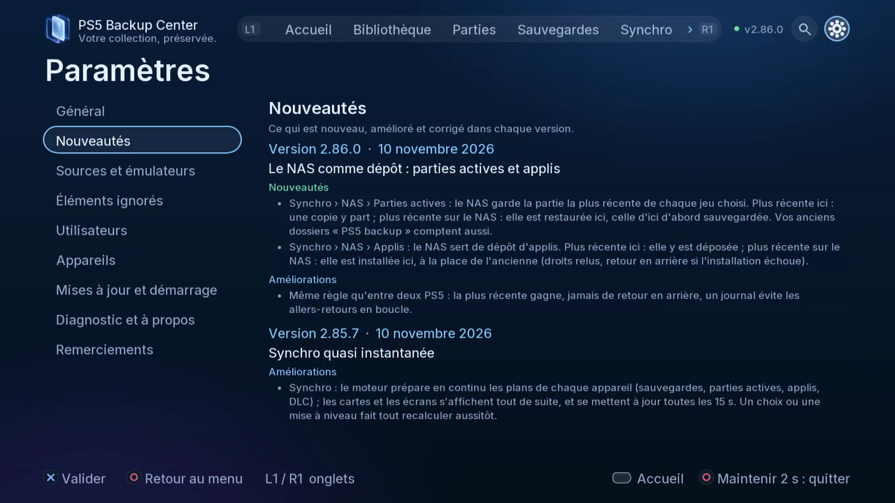

# Paramètres et mises à jour

Personnaliser l’interface et maintenir le moteur.

## Où le trouver

Télé : Paramètres. L1/R1 change les onglets ; ouvrez la roue dentée pour Paramètres.

Web : mêmes espaces dans la navigation du navigateur associé ; utilisez les boutons et cases à cocher.

## Étapes

1. Dans Général, choisissez parmi 19 langues et huit thèmes ; effets, musique et volume sont distincts.

*Les huit aperçus de thèmes sont réunis ici. Sons de l’interface, musique d’ambiance et volume se règlent séparément.*

2. Consultez Sources, Éléments ignorés, Utilisateurs et Appareils. Avant de relier des ID, vérifiez qu’ils appartiennent à la bonne personne.
3. Dans les mises à jour, vérifiez version installée et proposée, puis Nouveautés. Le dossier PBC Update sur USB permet la découverte hors ligne.

*Nouveautés permet de relire les changements par version. Il s’agit de la page des paramètres, pas d’une confirmation d’installation.*

4. Laissez les redémarrages demandés se terminer puis vérifiez version et diagnostic. Fermer l’interface télé ne coupe pas le moteur ni son interface web.
5. Remerciements présente auteurs, licences et sources des composants.

## Précautions

Fermez le jeu ou l’application concernée avant restauration, remplacement ou déplacement. Vérifiez compte, sens et destination ; lisez les confirmations et conservez une copie indépendante des données importantes. Les copies de sécurité et vérifications réduisent les risques sans constituer une garantie absolue.

## Captures à prévoir

theme variants, language menu, update prompt, credits / thèmes, langues, mise à jour, crédits

[Inventaire des captures](screenshot-plan.md) · [Index](README.fr-CA.md)
