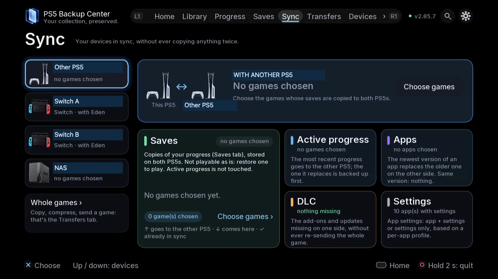

# Choose the right sync workflow

## Choose what should match

| Section | What is synchronised | What to check |
|---|---|---|
| Saves | Stored copies | Selection, versions and destination storage |
| Active progress | The progress used to resume play | Receiving accounts, direction and conflicts |
| Apps | App versions | Version, fingerprint and whether the app is closed |
| Settings | App configuration according to its profile | App only, app with settings, or settings only |
| DLC | Inventory and supported missing-component transfers | Platform, base game and supported operation |

Whole games belong in **Transfers**. Keeping stored save copies on both devices does not itself replace playable progress.

*Choose the device first, then the content: stored copies, active progress, apps, DLC or settings.*

## Where to find it

TV: **Sync**, choose the device at left and open the relevant section. Web: **Sync**, select the same device and section. Inspect **Tasks** for execution and results.

## Two PS5 consoles

1. Pair the consoles through **Devices**. Check which console is local and which is receiving.
2. Open **Sync**, select the other PS5, then choose one section. Start with a small, explicit selection.
3. For stored copies, review which games and versions are included and whether newly discovered games should be added automatically. That selection option is different from automatic unattended sync, which is future work.
4. For active progress, verify the account pair, direction, progress and play time. Close the game on both consoles. Where both sides changed, choose the intended progress rather than assuming the date resolves the conflict.
5. For apps, close the target app and review versions and fingerprints. Equal version labels with different contents need a decision. Select the settings scope supported by that app's profile.
6. Read the proposed changes, choose **Sync now** when appropriate, and follow **Tasks**. Reopen the comparison to inspect the resulting state.

## NAS depot

Choose the NAS in **Sync**. Stored copies, active progress and apps are separate sections. For active progress, the depot holds the chosen stored version used to bring consoles up to level; it does not run the game on the NAS. For apps, it holds app versions for installation on a console. Check direction before accepting a local replacement. DLC and app-settings synchronisation in this view remain PS5-to-PS5 workflows.

## Switch and Eden / ProsperoEden

Prepare JKSV exports and start ftpd on the Switch. Open the Switch device in **Sync**, check the game and profile on each side, review the comparison and direction, then confirm. When sending back to the Switch, complete the JKSV import steps: copying an export is not the same as applying it to the active Switch save. Direct Switch-to-Switch sync is future work.

## DLC and packages

An inventory or a discovered .pkg is not an installation. Switch add-on transfers between PS5s concern supported files missing from the receiving game's emulator folder. PS5 DLC installation through an installer and Orbit / PatchDL bridges are future work.

## Refresh and recovery

Prepared plans make the comparison appear quickly; they do not mean continuous automatic sync. If a device is offline, reconnect and refresh before accepting an old proposal. After interruption, inspect Tasks and the refreshed comparison before retrying.

[Back to guides](README.md)
