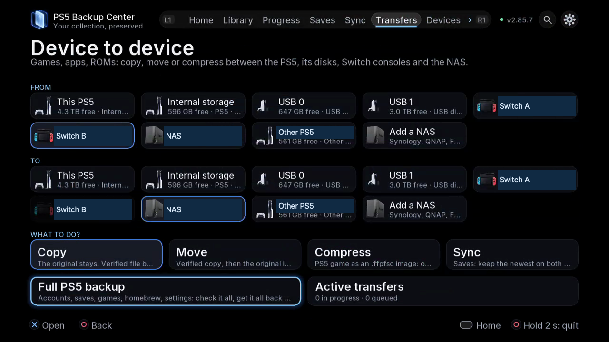

# Copy or move a whole game

## Choose the operation

**Copy** retains the source. **Move** removes the source after the destination copy has been verified. Compression changes the representation of the game; it does not back up active progress by itself. Check save components separately.

*FROM and TO are separate choices. Review both before choosing Copy or Move.*

## Where to find it

TV: **Transfers**, or open a game's details in **Library**. Web: **Transfers**, with the same source, destination and operation choices. Progress and errors appear in **Tasks**.

## Step by step

1. Close the game on the source and receiving console. If the title is running, stop here instead of working around the refusal.
2. Select the source device and actual storage disk. Select the destination separately and check available space.
3. Choose **Copy** or **Move**, then the title. Review included data; a game, its DLC and its player saves are distinct components.
4. If a format choice is offered, check the receiving system's support for folder, .exfat or .ffpfsc. Review minimum system, SDK and backport evidence. A warning is not resolved by choosing a different filename.
5. For another PS5, verify the receiving disk and account. Review the final summary and start the task only when direction and scope are correct.
6. Wait for copy verification and installation / registration steps to finish. Do not unplug a disk simply because the copying percentage reached 100%.
7. Read the final task result. Refresh the receiving Library and check location and format. A completed transfer is distinct from a successful launch; test the title when appropriate.

## Image tools

Use the dedicated tools for compression, decompression, extraction, verification, AMPR indexing or read-speed measurement. Read the explanation for the selected tool: inspection and repair do not have the same effects. Do not change read-only settings or run repair to compensate for an unrelated transfer error.

## If a move fails

Keep both storage devices connected. Read which phase failed before deleting anything. Do not manually erase the source on the assumption that the destination is complete. Record the task's error and inspect the destination before deciding on recovery.

## Different operation: full PS5 backup

The full-backup checklist groups account, save, app, registration, capture and startup data according to the offered categories. It is not a bootable clone or the future full-console restore wizard. Review the category list and destination independently of a game transfer.

[Back to guides](README.md)
