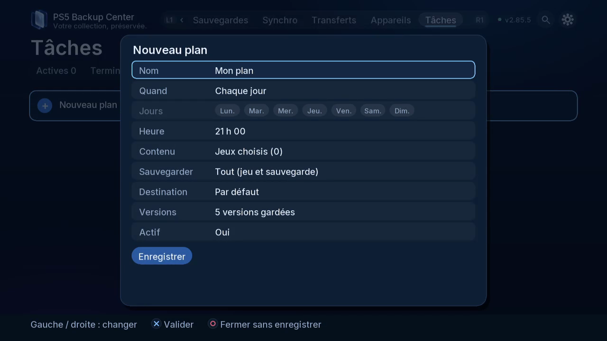

# Programmer un plan de sauvegarde

## Objectif et accès

Un plan répète une sauvegarde choisie sans refaire ses réglages à chaque passage. Télé et web : **Tâches**, ouvrez l’éditeur de plans ; la fiche d’un jeu propose aussi **Plans programmés…**. Un plan récurrent de sauvegarde se distingue de la future synchro automatique déclenchée à la fermeture d’un jeu.

## Préparer le plan

1. Choisissez un modèle si son périmètre convient, sinon un plan personnalisé.
2. Donnez un nom reconnaissable. Choisissez les jeux ou les règles proposées et vérifiez comment les nouveaux jeux sont inclus.
3. Choisissez les composants. Un plan limité aux parties ne protège pas les fichiers du jeu ; un plan limité à l’appli ne contient pas nécessairement sa configuration.
4. Choisissez la destination et vérifiez identité du disque et espace libre. La destination doit être accessible à l’heure prévue.
5. Choisissez à la demande, chaque jour ou les jours et l’heure proposés. Vérifiez l’horaire affiché ; fermer l’interface télé ne coupe pas le moteur.
6. Réglez le nombre de versions conservées et vérifiez le périmètre de rotation. Une rotation ne remplace pas une copie indépendante de longue durée.
7. Enregistrez, puis rouvrez le plan pour vérifier ses choix. Si cela convient, lancez-le une fois à la demande et examinez le résultat de la tâche.

## Suivre et modifier

Dans Tâches, distinguez plan enregistré et exécution en attente, en cours, terminée ou en erreur. Pour modifier le périmètre, éditez, enregistrez et rouvrez le plan. Mettez-le en pause avant de changer de destination si vous ne voulez pas qu’il se déclenche entre-temps. Annuler une exécution et suspendre un plan récurrent sont deux choix différents.

## Vérifier le résultat

Consultez le rapport et les versions attendues dans Sauvegardes. Un plan présent dans l’éditeur ne prouve pas qu’une exécution programmée a eu lieu. Si la destination était absente, examinez erreur et file existante avant de relancer.

[Retour aux guides](README.fr.md)

*Choisissez horaire, composants, destination et versions conservées avant d’enregistrer le plan.*
