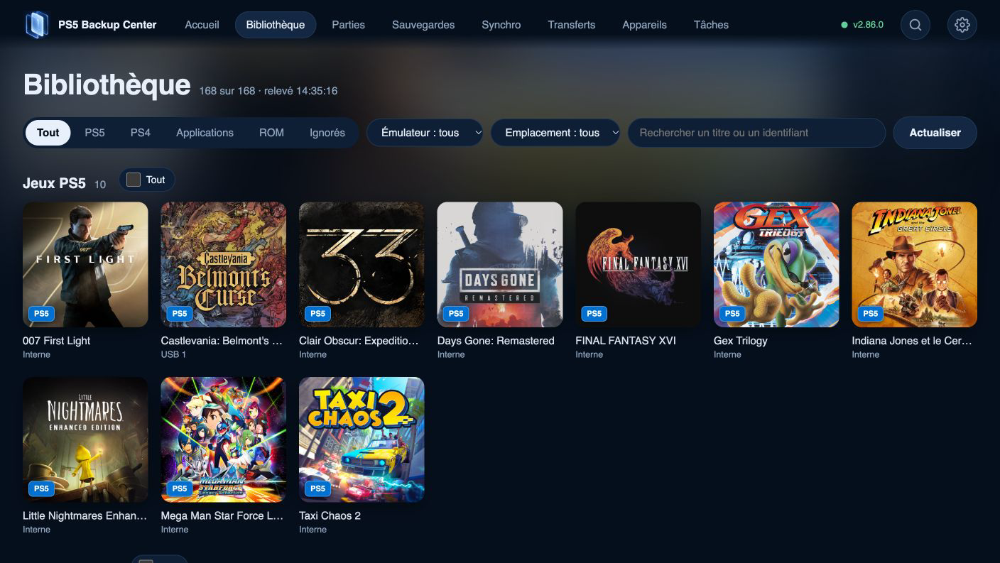

# Utiliser le web et le moteur en arrière-plan

## Trois composants, un moteur

L’application télé est l’interface à la manette. L’application web est l’interface du navigateur. Le moteur d’arrière-plan sert les pages web et réalise scans, sauvegardes, transferts et suivi des tâches. Fermer une interface ne coupe pas à lui seul le moteur. Éteindre la console ou arrêter le moteur est une autre action.

## Associer et commencer

1. À la télé, ouvrez **Paramètres › Appareils**. Lisez l’adresse web et le code d’association actuels de votre console.
2. Ouvrez cette adresse sur téléphone, tablette ou ordinateur du même réseau local. Ne recopiez pas une adresse trouvée sur une capture ou une autre installation.
3. Saisissez le code à six chiffres et un nom reconnaissable pour le navigateur, puis associez-le. Cette association lui donne accès aux données et commandes de l’application.
4. Ouvrez Bibliothèque et ses filtres. Consultez une fiche et ses composants, puis Tâches. Le web utilise boutons et cases à cocher plutôt que les raccourcis de manette.
5. Lancez une opération après vérification de sa destination et de son périmètre. Suivez le résultat final dans Tâches. Quitter l’onglet ou l’application télé ne revient pas à annuler la tâche.

## Revenir plus tard

Rouvrez l’adresse actuelle de la console. Un navigateur déjà associé peut conserver son association ; un autre navigateur ou un stockage effacé peut demander une nouvelle association. Après mise à jour, laissez l’interface se recharger puis vérifiez les versions si les informations semblent anciennes.

## En cas de déconnexion

Vérifiez console, moteur et réseau local, puis relisez l’adresse actuelle à la télé. Examinez les tâches existantes avant de recommencer. Ne publiez ni adresse, ni code, ni jeton de navigateur dans un signalement ; ne redirigez pas le port local du moteur vers Internet.

## Comprendre les états

Une page web qui répond ne prouve pas qu’une sauvegarde particulière a fini. Fermer l’interface télé ne prouve pas non plus l’arrêt du moteur. Contrôlez rapport et version produite. Sur mobile, la disposition s’adapte ; les commandes gardent les mêmes concepts que sur la télé.

[Retour aux guides](README.fr.md)

*Le navigateur propose les filtres de contenu, d’émulateur et d’emplacement de la bibliothèque.*
