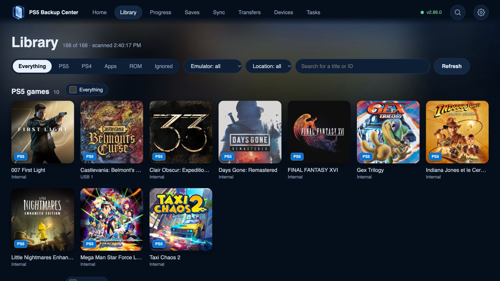

# Use the web app and background engine

## Three parts, one engine

The TV app is the controller interface. The web app is the browser interface. The background engine serves the web pages and performs scans, backups, transfers and task tracking. Closing either interface does not itself stop the engine. Turning off the console or stopping its engine is different.

## Pair and start

1. On TV open **Settings › Devices**. Read the current web address and pairing code on your own console.
2. Open that address on a phone, tablet or computer on the same local network. Do not use an address copied from a screenshot or another installation.
3. Enter the current six-digit code and a recognizable browser/device name, then pair. Treat pairing as granting that browser access to the app's data and commands.
4. Open Library and inspect the filters. Open a title to check its components, then inspect Tasks. The web interface uses buttons and checkboxes rather than controller shortcuts.
5. Start an operation only after reviewing its destination and scope. Follow its final result in Tasks. Leaving the browser tab or TV app is not the same as cancelling the task.

## Return later

Reopen the console's current address. A previously paired browser can retain its association; another browser or cleared browser storage may require pairing again. After an update, allow the interface to reload, then verify the app/engine version if the displayed information seems stale.

## If disconnected

Check that console and engine are still running and the device is on the intended local network. Read the console's current address again. Inspect existing Tasks before restarting an operation. Do not publish the address, pairing code or browser token in a bug report, and do not forward the engine's local port to the internet.

## Operating boundaries

A responsive web page does not prove that a particular backup completed. Conversely, closing a TV window does not prove the engine stopped. Use the task report and resulting version to confirm an operation. A mobile browser adapts its layout; controls and paths remain the same concepts as the TV interface.

[Back to guides](README.md)

*The browser provides content, emulator and location filters for the same library.*
