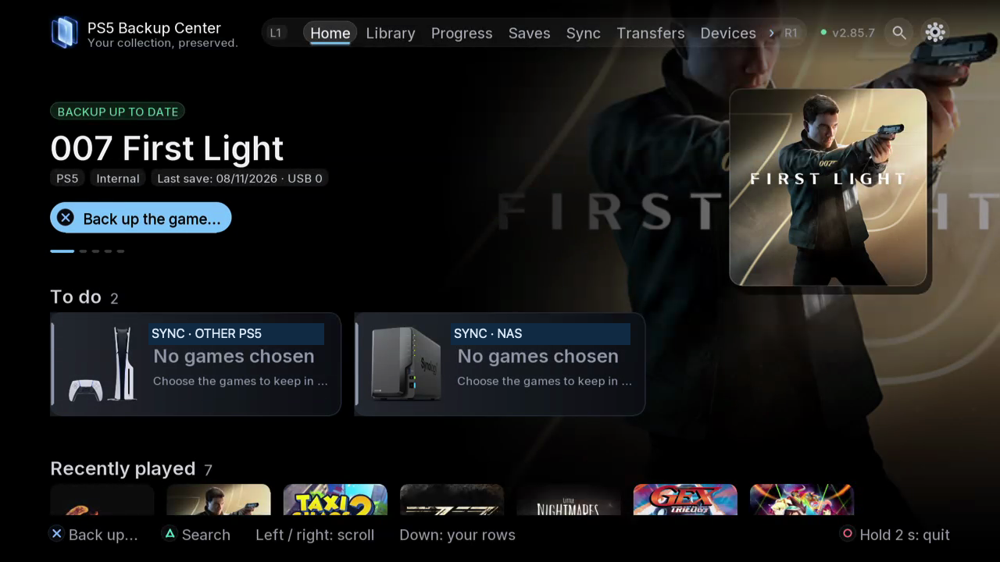

# Home and the notification centre

Home turns the console inventory into actions to consider: games without a known backup, newer copies, duplicates, comparisons to run, items to check, device sync and ongoing tasks. The To do cards appear according to the current inventory and device state.

## Where to find it

TV: Home, then move down from the featured title to **To do** and the shelves below. Web: Home, scroll through the same sections and open the relevant card. TV uses controller navigation; the browser uses selectable cards and buttons.

## Read the notification before acting

| Card or state | What to check next |
|---|---|
| To back up | Which game and player's progress lack a known copy on the available storage? |
| Newer copy | Compare the candidate's content, progress and account before restoring. |
| Duplicates | Read the cleanup proposal and the versions that will remain. |
| Not yet compared | Run or await content comparison; dates alone do not establish duplication. |
| To check | Inspect the copy and the reported issue before deleting or overwriting it. |
| Sync · device | Check the selected games, direction and conflicts for that device. |
| Task progress | Read the operation, percentage and estimated time, then open Tasks for the result. |

The cards use category colours and covers to distinguish work. A count describes the affected selection; it is not a promise that every game on every disk has been synchronised. “No games chosen” is a selection state, not a sync failure. “Everything is in sync” concerns the selected scope.

## Step by step

1. Review the featured title and To do cards before starting another task.
2. Open the relevant card. Check the affected game, player and storage rather than accepting an action from the count alone.
3. Compare or select the intended content, read the summary and confirmations, then start only the intended operation.
4. Follow Tasks to the final result. Return to Home and allow the inventory and notification state to refresh.
5. Scroll further for recently played titles, PS5/PS4 content, saves without an installed game, content available elsewhere, retro platforms and applications. Shelves depend on what is found.

## Use the right space

Library answers what content is available; Progress shows the playable save by player; Saves manages stored copies. Sync aligns selected content across devices, Transfers handles whole games, Devices configures destinations and peers, Tasks tracks work and plans, and Settings manages language, themes, sources, users, updates and credits. Home links these spaces through the notifications; opening a card is not itself proof of a completed operation.

*The To do area sits between the featured title and the content shelves.*
