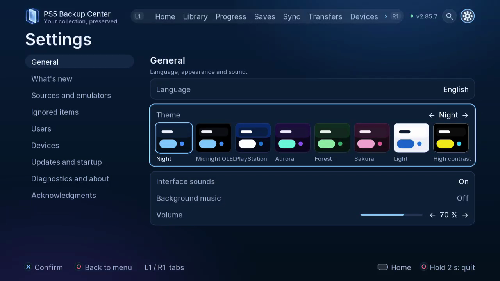
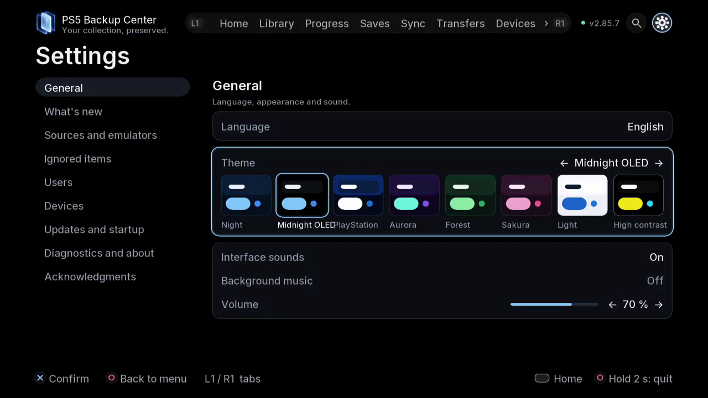
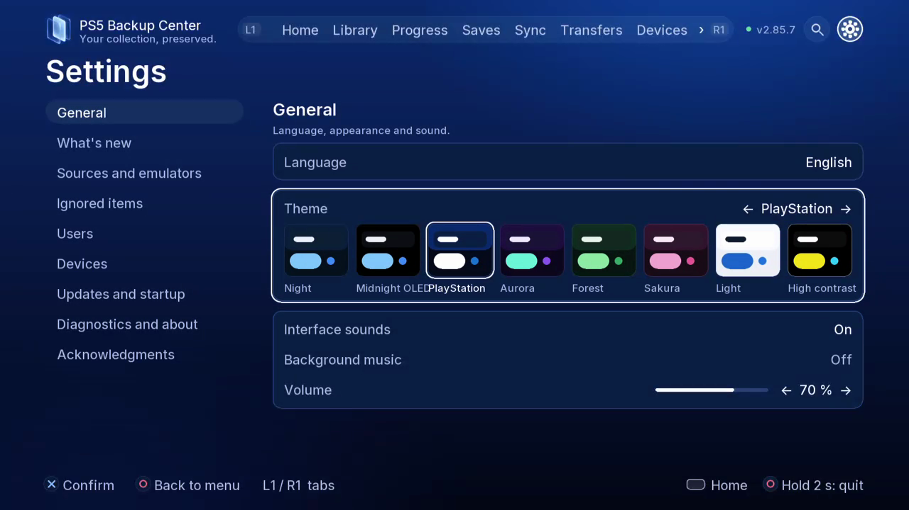
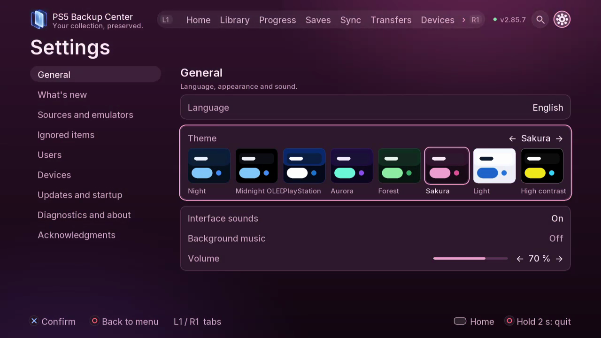
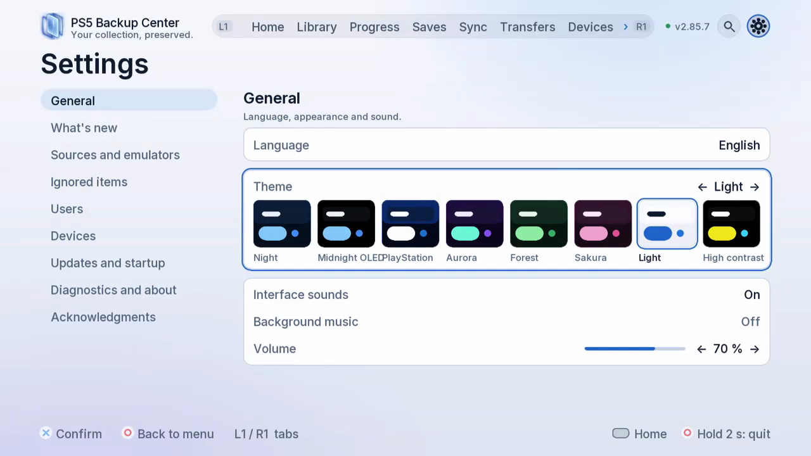
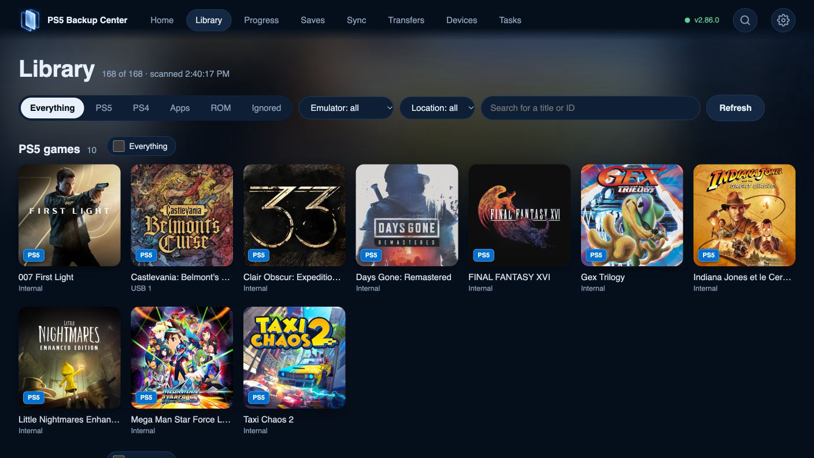

# PS5 Backup Center media

[Back to the project](../README.md) · [Browse the guides](guides/README.md)

## Themes

The TV app offers eight themes under **Settings → General**. These five captures show the same settings screen with different themes selected. See [Settings and updates](guides/06-settings.md) for the steps.

| Night | Midnight OLED | PlayStation |
| --- | --- | --- |
|  |  |  |

| Sakura | Light |
| --- | --- |
|  |  |

## Application screenshots

Explore [Home and the notification centre](guides/17-home-notifications.md) or [set up the web app](guides/16-web-engine.md).

| TV app | Web interface |
| --- | --- |
|  |  |
