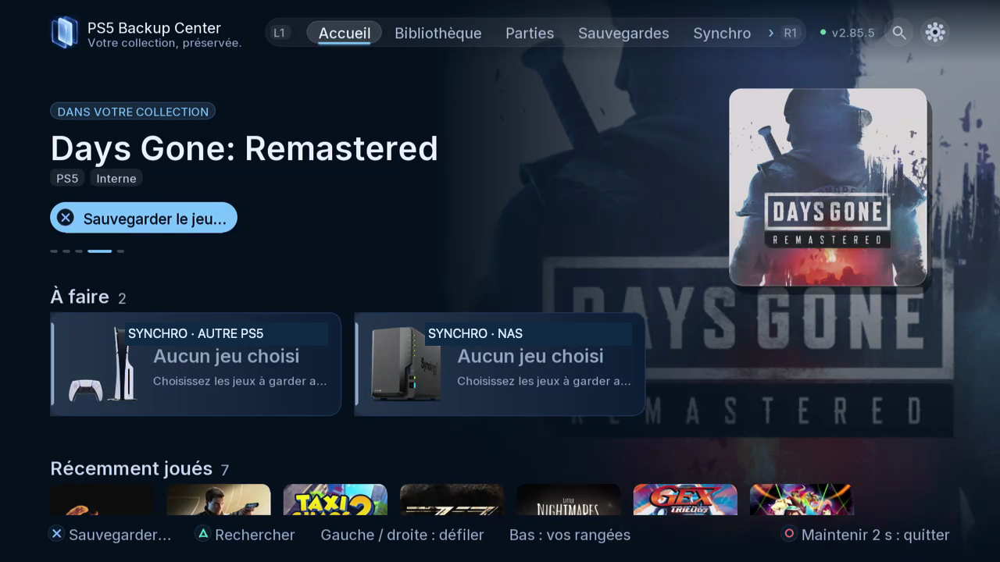
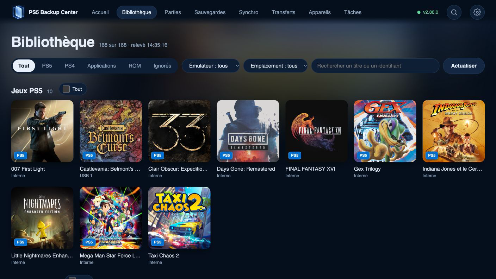

<p align="center">
  
</p>

[English](../../README.md) · [Français](README.fr.md) · [Français (Canada)](README.fr-CA.md) · [Español](README.es.md) · [Español (Latinoamérica)](README.es-419.md) · [Português (Brasil)](README.pt-BR.md) · [Português (Portugal)](README.pt-PT.md) · [Deutsch](README.de.md) · [Italiano](README.it.md) · [Nederlands](README.nl.md) · [Polski](README.pl.md) · [Türkçe](README.tr.md) · [Русский](README.ru.md) · [简体中文](README.zh-Hans.md) · [繁體中文](README.zh-Hant.md) · [日本語](README.ja.md) · [한국어](README.ko.md) · [Tiếng Việt](README.vi.md) · [العربية](README.ar.md)

<p align="center">
  
</p>

<p><strong>Version 2.99.5</strong> · Gardez la même progression des émulateurs Switch et Switch 2 sur vos deux PS5, agissez sur plusieurs jeux de l'autre PS5 d'un coup, et soutenez le projet avec le ♥ en haut à droite. L'application cherche et installe elle-même ses mises à jour.</p>

<p align="center">
  <a href="../../CHANGELOG.md"></a>
  <a href="../../LICENSE"></a>
  
  
  
  
</p>

<p align="center">
  <b>Sauvegarder, comparer et restaurer les parties et les jeux de votre PS5 — et les sauvegardes Switch, Switch 2 et d'émulateurs autour.</b><br>
  Un moteur sur la console, une app télé à la manette, la même interface dans n'importe quel navigateur. Sans PC, sans autre outil, sans autre port.
</p>

<p align="center">
  <a href="../guides/01-start.fr.md">Premiers pas</a> ·
  <a href="../media.md">Médias</a> ·
  <a href="#installer">Installer</a> ·
  <a href="#fonctions">Fonctions</a> ·
  <a href="#comment-ça-marche">Comment ça marche</a> ·
  <a href="#compatibilité">Compatibilité</a> ·
  <a href="#feuille-de-route">Feuille de route</a> ·
  <a href="#questions-fréquentes">FAQ</a> ·
  <a href="../../README.md">English</a>
</p>

---

## Votre collection. Vos parties. Vous gardez la main.

PS5 Backup Center réunit jeux, applications, ROMs et sauvegardes : sauvegardez, comparez, restaurez, transférez et synchronisez depuis la télé ou le navigateur. Un logiciel libre, sans abonnement.

## Pourquoi

Une sauvegarde PS5 vit à un seul endroit, sur un seul compte, sur une seule console. Celles des émulateurs sont dispersées dans une douzaine de dossiers. Celles de la Switch sont sur un autre appareil, derrière JKSV. On découvre souvent qu'on n'avait pas de copie le jour où on en a besoin.

PS5 Backup Center en garde une copie datée et vérifiée — sur une clé USB, sur votre NAS ou sur une autre console — et permet de remettre n'importe quelle version. Il lit ce que contient une sauvegarde : il sait dire quelles copies sont vraiment différentes et lesquelles sont des doublons.

Il fait partie de **[PS5 Center](../product-family.fr.md)**, une petite famille d'outils libres et gratuits construits sur le même moteur.

> [!NOTE]
> Tout ce qui est marqué *Disponible* fonctionne aujourd'hui ; ce qui est marqué *Prévu* n'est pas encore dans l'app.

## Fonctions

<table>
<tr>
<td width="50%" valign="top">

### Sauvegardes
- **Sauvegardes PS5, compte par compte** — chaque jeu indique *à jour*, *console plus récente*, *plus récent dans un backup* ou *jamais sauvegardé*.
- **Sauvegarder un jeu ou tout un compte** en un appui ; des plans programmés pour le reste.
- **Une avancée lisible** — le texte écrit par le jeu (mission, %, niveau, temps), plus un catalogue qui lit dans les sauvegardes (ELDEN RING, Expedition 33, Cyberpunk 2077…) et un lecteur générique Unreal / JSON.
- **Comparer par le contenu, pas par la date** — une empreinte repère les copies identiques, l'avancée dit laquelle va le plus loin.
- **Restauration vérifiée** — contrôle d'abord, copie de sécurité, jeu fermé, le bon compte (re-signée si l'identifiant diffère) ; aussi directement depuis le NAS.
- **Switch ↔ PS5** — les sauvegardes JKSV d'une Switch (ftpd) associées à vos jeux Eden / ProsperoEden, profil par profil, dans les deux sens.

</td>
<td width="50%" valign="top">

### Des backups qu'on gère
- **Toutes les versions, partout** — par jeu, chaque copie sur chaque disque, le NAS et l'autre PS5 : date, emplacement, taille, avancée, *protégée*.
- **Faire le tri sans risque** — doublons repérés par le contenu, aperçu avant nettoyage, corbeille de 30 jours avec *Remettre* ; bouton à maintenir 5 s avant toute action destructrice. Les copies d'un autre compte ne sont jamais proposées au nettoyage.
- **Même compte PSN, mêmes backups** — les copies faites sur une autre console sont reconnues toutes seules ; les anciens identifiants peuvent être nommés et repris sur votre compte actuel.
- **Sauvegarde complète de la PS5** — comptes, sauvegardes, inscriptions des jeux, homebrews et leurs données, réglages de démarrage, captures, chacun avec sa taille.

</td>
</tr>
<tr>
<td valign="top">

### Deux PS5 qui travaillent ensemble
- **Jumelage avec un seul code à 6 chiffres** — confiance dans les deux sens ; l'autre console apparaît dans Appareils avec son nom, son IP, son système et ses disques.
- **Envoyer une sauvegarde ou un jeu entier** — copié, vérifié et installé là-bas (ShadowMountPlus), dans le format que son système sait monter (`.ffpfsc`, `.exfat` ou tel quel), sauvegarde restaurée sur le compte choisi.
- **Vérifier avant d'envoyer** — version du jeu, SDK de ses exécutables, système minimum déclaré, backport trouvé : un avertissement clair si l'autre console est trop ancienne.
- **La bibliothèque de l'autre PS5** — parcourir d'ici ses jeux, applis et parties (télé et web), voir ce qui est *à jour ici / là-bas*, et sauvegarder à distance ses jeux et ses parties.
- **Agir sur l'autre console** — y ouvrir l'app, y désinstaller un jeu (parties sauvegardées d'abord), voir la version qui y est installée.
- **Par Internet aussi** — une liaison chiffrée, facultative, joint une PS5 loin de chez vous (port 52373, à rediriger sur la box).

</td>
<td valign="top">

### Synchro
- **Un onglet, une carte par appareil** — une autre PS5, une Switch, le NAS ; plans tenus prêts par le moteur, les écrans se remplissent tout de suite.
- **Sauvegardes** — les jeux choisis gardent leurs copies des deux côtés ; ajout seulement, rien n'est écrasé.
- **Parties actives** — la partie la plus récente gagne et part sur l'autre console ; celle qui est remplacée est sauvegardée d'abord ; jamais pendant que le jeu tourne, jamais en boucle, vous tranchez si les deux ont bougé.
- **Applis et leurs réglages** — même version sur les deux PS5, remplacement sûr avec retour arrière ; réglages par profil d'appli.
- **DLC et mises à jour** — inventaire par jeu et bibliothèque de paquets ; les DLC Switch manquants copiés d'une PS5 à l'autre.
- **Le NAS comme dépôt** — pour les parties actives et les applis.

</td>
</tr>
<tr>
<td valign="top">

### Jeux et transferts
- **Onglet Transferts** — *depuis* et *vers* (cette PS5, l'interne, l'USB, une Switch, le NAS, l'autre PS5), puis Copier, Déplacer, Compresser ou Synchroniser.
- **Copier ou déplacer un jeu PS5** entre l'interne et un disque USB : relecture SHA-256, réinscription ; l'original n'est supprimé qu'après vérification.
- **Outils d'image** — compresser en `.ffpfsc`, décompresser, créer ou extraire un `.exfat`, vérifier et réparer, lecture seule, test de vitesse, index AMPR. Avec le code de PS5 Game Compressor, dans notre moteur.
- **Fichiers** — copier, déplacer ou supprimer n'importe quel fichier ou dossier entre cette PS5, l'USB, le NAS, une Switch et l'autre PS5 ; la suppression demande plusieurs confirmations.
- **Désinstaller un jeu** — ici ou sur l'autre PS5 ; les parties sont sauvegardées d'abord et l'image du jeu est gardée par défaut.
- **Un jeu en cours n'est jamais touché** — et les applis gardent leurs droits d'exécution quand elles voyagent.

</td>
<td valign="top">

### Bibliothèque, appareils, interface
- **Une seule bibliothèque** — jeux PS5 et PS4, applications, ROM des émulateurs connus (plus la détection générique), noms et icônes officiels, même pour un jeu dont il ne reste que la sauvegarde ; chaque jeu montre son stockage et son vrai disque.
- **Appareils** — disques USB, NAS et PC (partages **SMB 2/3**, FTP, **FTPS** quand il est proposé), Switch, autres PS5. Se connecter, parcourir, choisir le dossier, tester, enregistrer.
- **L'Accueil comme centre de notifications** — ce qu'il faut sauvegarder, les copies plus récentes, les doublons, l'état de la synchro, les tâches en cours avec le temps restant.
- **Télé et web au même niveau** — téléphone ou ordinateur, associé par un code à 6 chiffres ; **19 langues**, 8 thèmes, sons.
- **Mises à jour toutes seules** — recherchées automatiquement sur ce dépôt, annoncées à l'Accueil, installées automatiquement si vous le voulez ; seuls les fichiers modifiés, vérifiés, version précédente gardée pour revenir en arrière ; aussi depuis une clé USB, sans réseau.
- **Alimentation** — redémarrer la PS5 depuis l'app (le mode repos n'est volontairement pas proposé).

</td>
</tr>
</table>

## Le centre de notifications, directement dans l’Accueil

L’Accueil propose jeux à sauvegarder, copies plus récentes, doublons, comparaisons et vérifications, synchronisation et tâches en cours. Ouvrez une carte pour examiner le contenu concerné puis suivez le résultat dans Tâches. Descendez aussi vers jeux récents, parties sans jeu installé, plateformes rétro et applications.

[Découvrir l’Accueil et ses notifications](../guides/17-home-notifications.fr.md).

## Les neuf espaces

- **Accueil** — Notifications, jeux récents et contenus disponibles ailleurs.
- **Bibliothèque** — Jeux, applications et ROMs ; filtres, recherche et fiches.
- **Parties** — Parties actives sur la console, par joueur.
- **Sauvegardes** — Copies rangées, versions, comparaison et nettoyage.
- **Synchro** — Copies, parties actives, applis, réglages et inventaire des DLC.
- **Transferts** — Jeux entiers, copie, déplacement et outils d’images.
- **Appareils** — Disques, NAS, Switch et PS5 associées.
- **Tâches** — File, opérations en cours, rapports et plans.
- **Paramètres** — Langues, thèmes, sources, utilisateurs, mises à jour et crédits.

[Consulter les guides](../guides/README.fr.md).

## Captures


*Le jeu actuel, les actions proposées et les titres récents.*



*Filtrez la collection par contenu, émulateur et emplacement dans le navigateur.*

## Comment ça marche

```text
      App télé             Navigateur, port 52370
          │                           │
          ▼                           ▼
┌─────────────────────── PS5 ────────────────────────┐
│ Moteur (continue quand l'app est fermée)           │
│  ├─ Catalogue : jeux, applis, ROM, parties         │
│  ├─ Plans, destinations, journal des tâches        │
│  ├─ Copie / restauration (vérifiée)                │
│  ├─ Chiffrement des sauvegardes (cœur Garlic)      │
│  ├─ Images de jeux (cœur Game Compressor)          │
│  └─ Connecteurs : USB · SMB · FTP · Switch · PS5   │
└─────────┬───────────────────────────┬──────────────┘
          ▼                           ▼
     Disques USB             NAS · Switch · PS5
```

- **Le moteur est le serveur.** Il sert l'API et les pages web sur un port fixe du réseau local (52370). L'app télé n'est qu'un client, comme le navigateur : la fermer n'arrête ni le web ni une sauvegarde en cours. La liaison facultative par Internet entre deux PS5 a son propre port (52373), coupée par défaut.
- **Aucun outil externe.** Le chiffrement et le montage des sauvegardes (Garlic SaveMgr / garlic-worker) et les images de jeux (PS5 Game Compressor) sont compilés dans le moteur. Rien d'autre à lancer, aucun autre port à ouvrir.
- **Sources détectées, jamais codées en dur.** Les émulateurs sont décrits comme des données ; leurs propres fichiers de réglages disent où sont les jeux. Un émulateur qu'on vient d'installer apparaît au scan suivant.
- **Tout laisse une trace sur disque.** Les tâches et leur progression sont journalisées : une sauvegarde interrompue reprend.

## Installer

> [!IMPORTANT]
> PS5 Backup Center est un homebrew. Il faut une PS5 qui fait déjà tourner des applications homebrew et des payloads. Ce projet ne fournit, ne documente et ne prend en charge aucun moyen d'y arriver.

### Installation manuelle
1. Téléchargez `PPSA99950.zip` depuis la [dernière version](https://github.com/consolecenterstudio/ps5-backup-center/releases/latest) et vérifiez son SHA-256 (dans `SHA256SUMS`).
2. Décompressez-le et copiez le dossier `PPSA99950` dans `/data/homebrew/` sur la console (FTP ou USB).
3. Lancez **PS5 Backup Center** depuis votre lanceur de homebrews. L'app démarre son moteur toute seule. Facultatif : `ps5-backup-center-<version>-engine.elf`, fourni avec la version, démarre le moteur seul depuis un chargeur d'ELF (port 9021).

### Par ProsperoStore — *bientôt proposé*
PS5 Backup Center (`PPSA99950`) sera proposé au catalogue communautaire [ps5-homebrew-catalog](https://github.com/darkxex/ps5-homebrew-catalog) qu'utilise ProsperoStore, avec le même zip et le même SHA-256 que la version GitHub.
4. Sur un téléphone ou un ordinateur du même réseau, ouvrez `http://<ip-de-la-ps5>:52370` et entrez le code à 6 chiffres affiché dans **Paramètres › Appareils**.

### Mises à jour
L'app cherche toute seule les nouvelles versions sur ce dépôt et affiche une bulle à l'Accueil ; **Paramètres › Mises à jour** liste les versions disponibles, peut installer automatiquement et revenir à la version précédente. Seuls les fichiers modifiés sont téléchargés et contrôlés ; le moteur et/ou l'app redémarrent avec un compte à rebours. En cas d'échec, l'ancienne version est remise. Fonctionne aussi sans réseau, depuis une clé USB. Seules les versions testées sur nos propres consoles sont publiées ici.

## Compatibilité

| Domaine | État | Précisions |
|---|---|---|
| **PS5** | ✅ Disponible | Environnement homebrew natif compatible requis ; la compatibilité dépend de la console, du format et du titre. L'app ne modifie pas le système. |
| Sauvegardes PS5 | ✅ Disponible | Sauvegarde, restauration vérifiée, vers un autre compte avec confirmation, comparaison par le contenu. |
| Jeux PS5 (installé, `.ffpfsc`, `.exfat`, dossier) | ✅ Disponible | Copier / déplacer interne ↔ USB, outils d'image. Un jeu en cours n'est jamais touché. |
| Jeux et sauvegardes PS4 sur PS5 | ✅ Listés et sauvegardés | Filtre PS4 dans la Bibliothèque. |
| Sauvegarde complète de la PS5 | Sauvegarde · Restauration prévue | Restaurer, et vers une autre PS5 : feuille de route. |
| **Switch** (réseau) | ✅ Disponible | ftpd ou SMB sur la Switch + sauvegardes JKSV. Synchro Switch ↔ Eden / ProsperoEden, profil par profil. |
| **Deux PS5** | ✅ Disponible | Association, bibliothèque à distance, sauvegarde à distance, envoi de jeux et de parties ; réseau local ou liaison facultative par Internet. |
| **SMB** (partages Windows, Synology, QNAP) | ✅ Disponible | SMB 2/3. Sert aussi à joindre une Switch par le réseau. |
| **Switch 2** (émulateur Églantine) | ✅ Disponible | Ses jeux (.nup / .nsp / .xci) dans la Bibliothèque sous *Switch 2*, avec jaquettes et sauvegardes ; réglages partagés entre PS5. |
| Switch en USB (Hekate UMS) | Prévu | Mode stockage de masse via Hekate ; le MTP (haze, DBI) n'est pas lisible par la PS5. |
| **NAS / FTP** | ✅ Disponible | Synology, QNAP, tout serveur FTP. **FTPS** (TLS explicite) quand il est proposé ; certificats auto-signés du réseau local acceptés, empreinte notée. |
| SFTP · NFS · WebDAV · cloud | 🗓 Prévu | SFTP d'abord. |
| Disques USB | ✅ Disponible | Reconnus par leur index témoin, même s'ils changent de port. |

### Émulateurs

D'après le catalogue du moteur (`engine/src/scan/emulators_catalog.cpp`) — ROM, sauvegardes, états et jaquettes, réglables à la main dans **Paramètres › Sources et émulateurs**. Un émulateur inconnu est détecté quand son dossier contient `roms`, `saves`, `states`…

| Émulateur | Plateforme | Émulateur | Plateforme |
|---|---|---|---|
| ProsperoEden / Eden | Switch | Snes9x | Super Nintendo |
| PS5SX2 | PlayStation 2 | Beetle PCE | PC Engine |
| SwanStation | PlayStation | FBNeo | Arcade |
| PSXS5 | PlayStation | Stella | Atari 2600 |
| PSP5 | PSP | PS64 | Commodore 64 |
| Mupen64Plus | Nintendo 64 | PSFlyCast | Dreamcast |
| Genesis Plus GX | Mega Drive / Master System / Game Gear / Mega-CD | Porpoise | GameCube / Wii |
| PS5X360 | Xbox 360 | PS5-ECAM | Wii U · 3DS · DS |
| Églantine | Switch 2 | | |

## Technique

| Couche | Technologie |
|---|---|
| Moteur | C++20, PS5 Payload SDK, LLVM/Clang. Payload en arrière-plan ; API HTTP `/api/v2/…` et web statique sur le port 52370. |
| App télé | App PS5 native en C++20 (`PPSA99950`), sur la base de ps5-native-app-boilerplate ; rendu maison, police Inter. |
| Web | JavaScript, HTML et CSS sans framework ni étape de build, servis par le moteur. |
| Sauvegardes | Cœur de Garlic SaveMgr / garlic-worker (chiffrement, montage, re-signature PS4/PS5) compilé dedans. |
| Images de jeux | Cœur de PS5 Game Compressor (`.ffpfsc`, `.exfat`, validation / réparation) compilé dedans. |
| Réseau | BearSSL (HTTPS, FTPS, liaison chiffrée entre PS5), client FTP maison (MLSD, passif, reprise de session TLS), libsmb2 (SMB 2/3). |
| Images | libwebp, stb_image, zlib. |
| Compilation | Reproductible : deux compilations depuis zéro donnent le même moteur, octet pour octet. |

## Feuille de route

**En développement** : même progression des émulateurs sur les deux PS5 (ProsperoEden, Églantine) ; installer un jeu sur l'autre PS5 depuis sa bibliothèque ; réveil par le réseau (Wake-on-LAN).

**À venir** : SFTP ; corbeille pour les copies du NAS ; mises à jour de toutes les consoles depuis une seule ; installation des DLC PS5 ; passerelles Orbit / PatchDL ; rangement, compression, déplacement et installation des jeux arrivés par Orbit ou BlackBox ; Switch ↔ Switch ; synchronisation automatique ; restauration complète guidée.

**Famille de produits** : PS4 Backup Center et PS5 Center sont des projets futurs. PS5 Center vise une gestion plus large des consoles, des jeux et des interactions entre appareils. PS5 Connector est un concept futur d’extension des capacités par des connecteurs. Leur périmètre sera précisé séparément.

Les 19 langues, huit thèmes, sons et musique font déjà partie de PS5 Backup Center.

## Remerciements et licences

PS5 Backup Center est un logiciel libre sous **GPL-3.0-or-later**. Il repose sur le travail de ces projets — merci. La même liste est dans l'app, **Paramètres › Remerciements**.

| Projet | Auteur | Licence | Rôle |
|---|---|---|---|
| [ps5-native-app-boilerplate](https://github.com/blackbearreloaded/ps5-native-app-boilerplate) | BlackBearReloaded | GPL-3.0-or-later | Base de l'app télé ; musique « Night Drive » |
| [PS5 Payload SDK](https://github.com/ps5-payload-dev/sdk) | ps5-payload-dev (John Törnblom et contributeurs) | GPL-3.0 | Bibliothèques, en-têtes, chaîne de compilation |
| [SharpProspero](https://github.com/SvenGDK/SharpProspero) | SvenGDK | GPL-3.0 | Conversion ELF et signature |
| [garlic-worker](https://github.com/earthonion/garlic-worker) | earthonion (merci à c0w-ar, hzhreal, Team-Alua) | GPL-3.0 | Chiffrement, déchiffrement, re-signature des sauvegardes PS4/PS5 |
| [Garlic SaveMgr](https://github.com/earthonion/garlic-savemgr) | earthonion | GPL-3.0 | Import, montage et export des sauvegardes PS5 |
| [PS5 Game Compressor](https://github.com/juma-sayeh/PS5-Game-Compressor) | juma-sayeh | GPL-3.0 | Compression, déplacement et validation des jeux |
| [BearSSL](https://bearssl.org) | Thomas Pornin | MIT | HTTPS et FTPS |
| [libsmb2](https://github.com/sahlberg/libsmb2) | Ronnie Sahlberg et contributeurs | LGPL-2.1-or-later | Partages SMB 2/3 (Windows, Synology, QNAP) |
| [libwebp](https://chromium.googlesource.com/webm/libwebp) | Google | BSD-3-Clause | Jaquettes WebP |
| [zlib](https://zlib.net) | Jean-loup Gailly, Mark Adler | zlib | Compression des vignettes |
| [stb_image](https://github.com/nothings/stb) | Sean Barrett | MIT / domaine public | Lecture des jaquettes |
| [Inter](https://rsms.me/inter) | Rasmus Andersson | SIL OFL 1.1 | Police de l'interface |
| [LLVM / Clang](https://llvm.org) | LLVM Project | Apache-2.0 avec exceptions LLVM | Compilateur |
| [titledb](https://github.com/blawar/titledb) | blawar et contributeurs | Données publiques | Noms des jeux Switch |
| [PlayStation-Titles](https://github.com/andshrew/PlayStation-Titles) | andshrew | MIT | Noms des jeux PS4 / PS5 |
| [Prospero Patches](https://prosperopatches.com) / Orbis Patches | prosperopatches.com, orbispatches.com | Service public | Icônes officielles des jeux PS5 / PS4 sans le jeu |
| tinfoil.media | Tinfoil | Service public | Icônes des jeux Switch absents de la bibliothèque |

**Merci aussi à** Elf-Arsenal+ (chargeur de payloads), [PS5 Payload Manager](https://github.com/itsPLK/ps5-payload-manager) d'itsPLK, [ShadowMount+](https://github.com/drakmor/ShadowMountPlus) de drakmor, Orbit et BlackBox (ergonomie et mises à jour), et Prospero Manager (référence pour les sauvegardes et les comptes).

## Contribuer

Le plus utile aujourd'hui : signaler un bug, traduire, et dire sur quel matériel ça marche. Lisez [CONTRIBUTING.md](../../CONTRIBUTING.md), puis ouvrez un ticket depuis l’onglet Issues de ce dépôt. Pour un problème de sécurité, voir [SECURITY.md](../../SECURITY.md) — pas de ticket public.

## Questions fréquentes

<details><summary><b>Peut-il effacer ou abîmer mes sauvegardes ou mes jeux ?</b></summary>

Une restauration est vérifiée d'abord et fait une copie de sécurité de la sauvegarde actuelle. Supprimer demande toujours confirmation, ne retire jamais une version protégée, et *cocher les doublons* garde toujours une copie de chaque contenu. Un jeu déplacé n'est effacé qu'après relecture et vérification de la copie. Un jeu en cours n'est jamais touché.
</details>

<details><summary><b>Faut-il un PC ou un autre homebrew lancé à côté ?</b></summary>

Non. Le moteur tourne sur la PS5 ; l'app télé et le web lui parlent. Le code de Garlic et de Game Compressor est intégré : ni l'un ni l'autre n'a besoin de tourner.
</details>

<details><summary><b>Peut-on remettre une sauvegarde sur un autre compte ou une autre console ?</b></summary>

Oui sur un autre compte de la même PS5, avec une confirmation explicite. Remettre une sauvegarde complète sur une autre PS5 est prévu.
</details>

<details><summary><b>Mon NAS a déjà des backups faits par un script. Je les perds ?</b></summary>

Non. Les dossiers datés existants sont lus comme des versions et peuvent être restaurés. *Ranger sous PBC Backup* ne fait que renommer ; si un dossier existe des deux côtés, il fusionne date par date sans rien écraser.
</details>

<details><summary><b>La Switch en USB ?</b></summary>

Pas encore. Aujourd'hui la Switch passe par le réseau (ftpd ou SMB, avec JKSV). L'USB via le mode stockage de masse de Hekate est prévu ; le MTP (haze, DBI) n'est pas lisible par la PS5.
</details>

<details><summary><b>C'est vraiment gratuit ?</b></summary>

Oui, et libre (GPL-3.0-or-later). Un lien « paye-moi un café » sera ajouté pour qui veut soutenir le travail ; rien n'est réservé aux donateurs.
</details>

## Historique des versions

Chaque version et ce qu'elle a apporté : [CHANGELOG.md](../../CHANGELOG.md) — le même historique que **Paramètres › Nouveautés** dans l'app.

## Soutenir le projet

PS5 Backup Center est gratuit et le restera : rien n'est bloqué, tout le monde a les mêmes fonctions et les mêmes mises à jour. Il est fait par un développeur indépendant, sur son temps libre et ses propres consoles. S'il a déjà sauvé une de vos parties, vous pouvez aider à payer les consoles de test, les disques et les outils. Merci ! Dans l'appli : le ♥ en haut à droite, ou Paramètres › Soutenir le projet.

### Crypto

| Coin | Network | Address |
|---|---|---|
| BTC | Bitcoin | `16J2KqxzzAwqrbdtsBAXLcfXySH3WEqvas` |
| ETH | Ethereum (ERC20) | `0xc8bdccce6d52570e059f58f0f4c5c6199bee298d` |
| BNB | BNB Smart Chain (BEP20) | `0xc8bdccce6d52570e059f58f0f4c5c6199bee298d` |
| SOL | Solana | `EyiGLmxw1b1AZxhVmpfP4cXYGTDuYJaWXonvKww2hDaD` |

Envoyez uniquement sur le réseau indiqué pour chaque adresse, sinon l'envoi est perdu. Ko-fi et Patreon arrivent bientôt.

### Cadeaux

Vous préférez offrir autre chose ? Cartes cadeaux (PlayStation Store, Amazon, Steam), abonnement offert (outils d'IA, crédits d'API, services) ou matériel de test sont les bienvenus. Envoyez codes cadeaux, abonnements offerts ou un lien de liste d'envies au studio : **consolecenterstudio@gmail.com**. Ne partagez jamais un compte : c'est souvent interdit par le service et risqué pour vous.

### Projets à financer

Les prochaines applis, **PS5 Center** (toutes vos consoles depuis un seul écran) et **PS5 Connector** (connecteurs pour NAS, partages et cloud), auront leur objectif et leur jauge, ici et dans l'appli (Paramètres › Projets à financer).

### Signaler un problème

Bugs et idées : [Issues](https://github.com/consolecenterstudio/ps5-backup-center/issues/new/choose) · questions et remerciements : [Discussions](https://github.com/consolecenterstudio/ps5-backup-center/discussions). Une ⭐ sur le dépôt aide aussi.

---

<p align="center">
  <sub>PS5 Backup Center est un projet communautaire indépendant, sans lien avec Sony Interactive Entertainment ni Nintendo, et non approuvé par eux.<br>
  « PlayStation », « PS5 », « PS4 » et « Nintendo Switch » sont des marques de leurs propriétaires respectifs.</sub>
</p>
