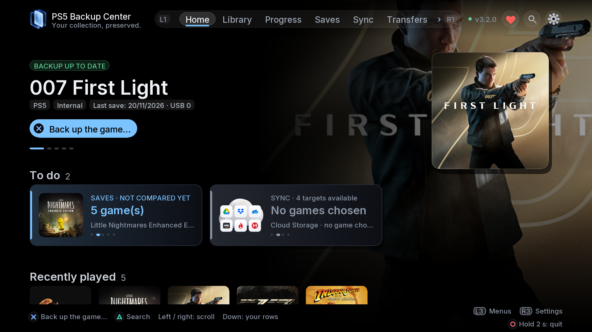

  

[English](../../README.md) · [Français](README.fr.md) · [Français (Canada)](README.fr-CA.md) · [Español](README.es.md) · [Español (Latinoamérica)](README.es-419.md) · [Português (Brasil)](README.pt-BR.md) · [Português (Portugal)](README.pt-PT.md) · [Deutsch](README.de.md) · [Italiano](README.it.md) · [Nederlands](README.nl.md) · [Polski](README.pl.md) · [Türkçe](README.tr.md) · [Русский](README.ru.md) · [简体中文](README.zh-Hans.md) · [繁體中文](README.zh-Hant.md) · [日本語](README.ja.md) · [한국어](README.ko.md) · [Tiếng Việt](README.vi.md) · [العربية](README.ar.md)

## 3.2.0

- 「ダウンロード」の「+ リンクを追加」でマグネットリンクや .torrent ファイルも追加できます。保存するディスクを選び（「設定 › ネットワーク」のものが先頭）、進行状況（ソース、速度、残り時間）を確認して、一時停止・再開・削除ができます（テレビとWeb）。
- ダウンロード › マイリンク：本体から出したすべてのリンク（BitTorrent、本体の .zip、MEGA、OneDrive）を QR コード、アドレス、停止方法とともに表示。MEGA と OneDrive のリンクもここに保存されます。
- プラン：保存先にすでにあるセーブやゲーム（どの PS5 がコピーしても内容が同じもの）は再コピーされず、結果に「最新です」と表示されます。確認のために読み直すことはありません。
- ダウンロード ›「ORBIT と BLACKBOX」：Orbit と BlackBox が本体にダウンロードしたもの（状態、ドライブ、サイズ、ファイルが見つからない）と一時ファイル（残っているアーカイブ、ダウンロード中、残り）を、アプリ側を変更せずに読み取って表示します。
- ゲームのツール、.pkg パッケージ、ダウンロード › Orbit と BlackBox に「インストール…」：その場でマウント（ドライブのゲームフォルダーへ移すだけでコピーなし、ShadowMount がマウント）、または別のドライブや別の PS5 にインストール（検証済みコピー、元は残すか削除）。
- Kraken .pkg の「インストール… › その場でマウント」：ゲームを本体に登録し、パッケージから直接起動します。何も展開しません。Kraken Mount がインストールされていればそれで、なければ内蔵版で行います（私たちのエンジンで Kraken Mount の仕組みを実行し、ampr-emu-ng、pgo_stub、dlc_emu は私たちがビルドしたもの。kstuff が必要）。ShadowMount が扱っているゲームや本体にインストール済みのゲームには触れません。最初の版です。試してください。

Dropbox の本番利用承認は審査中です。PS5 間の自動同期と別の本体へのインストールは初期版で、実機テストがまだ必要です。

  

[はじめに](../guides/01-start.ja.md) · [メディア](../media.md)

# PS5 Backup Center

**ゲームをダウンロード、インストール、転送。** ローカルネットワーク上のペアリング済みPS5からゲームを受信できます。テレビやブラウザーから、PS5、USBドライブ、NAS、クラウド間でセーブデータをバックアップ、比較、同期、復元できます。PS5のアプリやDLC、Switchや対応エミュレーターのセーブも管理できます。

[新機能 3.2.0](https://github.com/consolecenterstudio/ps5-backup-center/releases/tag/v3.2.0)

**あなたのコレクション。あなたの進行状況。あなたのバックアップ。**

バックアップが必要な内容を見つけ、既存のコピーを比較し、機器間のデータ交換を整理します。PS5 Backup Center は、一覧表示、バックアップ、同期、転送をテレビとブラウザーにまとめます。

**3.0.0 · GPL-3.0-or-later · 19 · 8**

**フォロー** · [X @CCenterStudio](https://x.com/CCenterStudio) · [YouTube @ConsoleCenterStudio](https://www.youtube.com/@ConsoleCenterStudio) · [Reddit @ConsoleCenterStudio](https://www.reddit.com/user/ConsoleCenterStudio/)

自由なソフトウェア。定額料金なし。

## できること

- ゲーム、アプリ、ROM を確認し、全体、セーブデータ、ステート、対応する設定を選択。
- 保存したコピーを比較し、世代を管理して、任意の世代ローテーション付きで定期プランを作成。
- テレビ用アプリを閉じた後もエンジンは動作し、ブラウザーでタスクを確認可能。

## ライブラリー · 同期

保管用バックアップと、プレイ中に使うセーブデータは別のものです。PS5 同士または NAS と維持するコピーを選びます。本体ごとにローカルユーザー ID が異なる場合があるため、受信先アカウントが重要です。Switch ↔ Eden / ProsperoEden では Switch 側で JKSV と ftpd を使います。アプリと対応設定には個別の比較規則があります。ゲーム全体は「転送」で扱います。

## 3.0 の新機能

- 機器の画面でNASか本体を追加し、保存前に相手を確認します。NASでは対応プロトコルを選び、接続テストとフォルダー選択を行います。PS5間はペアリングコードを確認し、SwitchではftpdとJKSVエクスポートを準備します。FTP / FTPS、SMB、WebDAVに対応しています。「用途」で、NASをセーブデータ用、同期用、またはその両方に使うかを選びます。
- クラウドはデバイス › クラウドを開きます。S3サービス（Amazon S3、Backblaze B2、Wasabi、Cloudflare R2、Scaleway、OVHcloud、Synology C2…）を選んでキーを入力します（QRコードで同じフォームがスマホに開くので、そこに貼り付けられます）。またはpCloud、Koofr、Nextcloudを自分のアカウントで使います。 スマートフォンからGoogle Driveと個人用OneDriveを連携できます。開発中のDropboxは登録数に制限があります。
- フルスクリーンキーボード.

## 2.98 の新機能

- **もう一台の PS5 のライブラリー**：そのゲーム、アプリ、セーブをここから閲覧（テレビとウェブ）し、リモートでバックアップできます。
- **ファイル**：この PS5、USB、NAS、Switch、もう一台の PS5 の間で任意のファイルをコピー・移動・削除。削除には複数回の確認があります。
- **ゲームのアンインストール**（この PS5 またはもう一台）。セーブは先にバックアップされます。
- FTP/FTPS に加えて **SMB 2/3**（Windows、Synology、QNAP）。**Églantine**（Switch 2）。アプリから本体を再起動。
- 自宅外の PS5 とつながる、任意の暗号化された**インターネット接続**（ポート 52373）。ローカルネットワークではポート 52370。

## インストール

1. [最新バージョン](https://github.com/consolecenterstudio/ps5-backup-center/releases/latest)から `PPSA99950.zip` をダウンロードし、SHA-256 を確認します（`SHA256SUMS`）。
2. 展開し、`PPSA99950` フォルダーを本体の `/data/homebrew/` にコピーします（FTP または USB）。
3. 自作ソフトのランチャーから **PS5 Backup Center** を開きます。アプリは自分でエンジンを起動します。任意：リリースの `…-engine.elf` は ELF ローダー（ポート 9021）からエンジンだけを起動します。

アプリはこのリポジトリの新しいバージョンを自動で確認し、ホームで知らせてインストールできます。前のバージョンにも戻せます。

## TV / Web

- **ホーム**
- **ライブラリー**
- **プレイデータ**
- **セーブデータ**
- **同期**
- **転送**
- **デバイス**
- **タスク**
- **設定**

## 設定

19言語と8テーマを選べます。操作音、背景音楽、音量は別々です。関連付けを変える前にソース、無視した項目、ユーザー、機器を確認します。更新内容は後から読み直せます。謝辞に作者、ライセンス、ソースを記載しています。

## その他のプロジェクト

PS5 Center は、範囲とロードマップを今後共に検討する、より幅広い将来のプロジェクトです。ゲームやアプリの管理だけに限定されず、まだ開発されていません。PS5 Connector は、コネクターと既存のソリューションによる本体機能の拡張を検討します。NAS、共有、USB は例であり、範囲は未確定です。試作品や公開日は発表していません。

## 支援する

PS5 Backup Center は無料で、これからも無料です。役に立ったら開発を支援できます（アプリでは右上の ♥）。暗号資産は下の表へ。表示されたネットワークでのみ送金してください。プレゼント、Ko-fi、Patreon、プロジェクトの目標：[Support the developer](../../README.md#support-the-developer)。

| Coin | Network | Address |
|---|---|---|
| BTC | Bitcoin | `16J2KqxzzAwqrbdtsBAXLcfXySH3WEqvas` |
| ETH | Ethereum (ERC20) | `0xc8bdccce6d52570e059f58f0f4c5c6199bee298d` |
| BNB | BNB Smart Chain (BEP20) | `0xc8bdccce6d52570e059f58f0f4c5c6199bee298d` |
| SOL | Solana | `EyiGLmxw1b1AZxhVmpfP4cXYGTDuYJaWXonvKww2hDaD` |

## はじめに

- [はじめに](../guides/01-start.ja.md)
- [日常のバックアップと復元](../guides/02-everyday.ja.md)
- [保存先とペアリング済み本体](../guides/03-destinations.ja.md)
- [ゲームと転送](../guides/04-transfers.ja.md)
- [エミュレーターとROM](../guides/05-emulators.ja.md)
- [設定と更新](../guides/06-settings.ja.md)
- [トラブルシューティング](../guides/07-troubleshooting.ja.md)
- [開発者向け](../guides/08-developers.ja.md)
- [プロジェクトと支援](../guides/09-project.ja.md)
