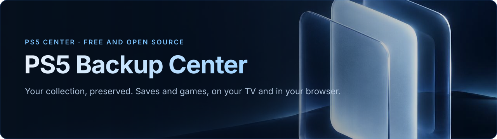

  

[English](../../README.md) · [Français](README.fr.md) · [Français (Canada)](README.fr-CA.md) · [Español](README.es.md) · [Español (Latinoamérica)](README.es-419.md) · [Português (Brasil)](README.pt-BR.md) · [Português (Portugal)](README.pt-PT.md) · [Deutsch](README.de.md) · [Italiano](README.it.md) · [Nederlands](README.nl.md) · [Polski](README.pl.md) · [Türkçe](README.tr.md) · [Русский](README.ru.md) · [简体中文](README.zh-Hans.md) · [繁體中文](README.zh-Hant.md) · [日本語](README.ja.md) · [한국어](README.ko.md) · [Tiếng Việt](README.vi.md) · [العربية](README.ar.md)

## 3.2.0

- Yerleşik ShadowMount'umuz (ShadowMountPlus 1.7, bizim derlememiz): yüklü ShadowMountPlus çalışmıyorsa oyun görüntüleri ve klasörleri yine de bağlanır ve kaydedilir — sisteme kanca yok, port yok; yüklü olan çalışır çalışmaz önceliklidir (Ayarlar › Oyunların bağlanması). Ayarları asla değiştirilmez.
- Başka yerdeki bir oyun için “Kur…” (NAS, bulut, diğer PS5), Dosyalar'dan: hedef PS5'i ve sürücüsünü seçersiniz; doğrulanmış kopya, ardından bağlama veya konsol ile kurulum. NAS ve bulut kaynaktır, asla hedef değildir.
- Web: “Bu PC'den kur…” (Dosyalar) — PC'deki bir oyun dosyası (.pkg veya görüntü) seçilen PS5'e ve sürücüye parça parça gönderilir, kesintiden sonra sürer, ardından bağlanır veya konsol ile kurulur.
- Ayarlar › Konsol araçları: Payload Manager'ın payload'ları ve çalışanlar — buradan başlatın veya durdurun (kstuff ve motorumuz korumalı, ShadowMountPlus düzgünce durdurulur) ve Payload Manager'ı açın; bir aracı yeniden başlatmak için artık konsolu yeniden başlatmaya gerek yok.
- Oyun kitaplıkları: NAS, bulut, USB sürücü veya diğer PS5 üzerindeki bir klasör Dosyalar'dan belirlenir; kurulu olmayan oyunları Ana Sayfa ve Kitaplık'ta («Yüklenecekler») görünür, seçilen PS5 ve sürücüye yüklenmeye hazırdır. Arka planda okunur, orada hiçbir şey değiştirilmez. Her .pkg başlığından tanınır: oyun, güncelleme ya da DLC (asla oyun sanılmaz: altına yerleştirilir, oyun yüklendikten sonra konsolla yüklenebilir), PS4 ya da PS5, fake PKG ya da resmî paket; Kraken yalnızca fake PKG biçimindeki bir PS5 oyunu için önerilir, aksi hâlde nedeni söylenir.
- Başka yerden «Yükle…»: biçimi seçin (kalıp, oyunun Kraken ile başlatılan ya da konsolla yüklenen .pkg'si ya da .pkg'ye dönüştürülüp yüklenen kalıp), tahmini süreyle; ardından numaralı adımlardan (kopyalama, doğrulama, dönüştürme, yükleme) oluşan tek bir görev, her adımın çubuğu, hızı ve kalan süresiyle. Her adımda durdurulabilir.
- İndirmeler'de “+ Bağlantı ekle” bir magnet bağlantısı veya .torrent dosyası da alır: kaydedileceği diski seçersiniz (önce Ayarlar › Ağ'daki), sonra ilerlemeyi (kaynaklar, hız, kalan süre) izler, duraklatır, sürdürür veya kaldırırsınız (TV ve web).
- İndirmeler › Bağlantılarım: konsoldan verilen tüm bağlantılar (BitTorrent, konsol .zip, MEGA, OneDrive), QR kodu, adresi ve durdurma seçeneğiyle. MEGA ve OneDrive bağlantıları orada saklanır.
- Planlar: hedefte zaten bulunan bir kayıt ya da oyun (aynı içerik, hangi PS5 kopyalamış olursa olsun) artık yeniden kopyalanmaz; özet “zaten güncel” der. Bunun için hiçbir şey yeniden okunmaz.
- İndirmeler › “ORBIT VE BLACKBOX”: Orbit ve BlackBox'ın konsola indirdikleri (durum, sürücü, boyut, dosya bulunamadı) ve geçici dosyaları (tutulan arşiv, süren indirme, kalan), onların tarafında hiçbir şey değiştirilmeden okunur.
- Bir oyunun araçlarında, .pkg paketlerinde ve İndirilenler › Orbit ve BlackBox'ta “Yükle…”: bulunduğu yerde bağla (diskinin oyun klasörüne taşınır, kopya yok, ShadowMount bağlar) ya da başka bir diske veya başka bir PS5'e yükle (doğrulanmış kopya, orijinal korunur veya silinir).
- Kraken .pkg için “Kur… › Olduğu yerde bağla”: oyun konsola bildirilir ve paketinden, hiçbir şey açılmadan çalışır — yüklüyse Kraken Mount ile, değilse yerleşik sürümümüzle (Kraken Mount'un işi motorumuzda; ampr-emu-ng, pgo_stub ve dlc_emu bizim tarafımızdan derlendi; kstuff gerekir). ShadowMount'un zaten aldığı veya konsolun kurduğu bir oyuna dokunulmaz. İlk sürüm, denenmek üzere.

Dropbox üretim onayı bekleniyor. PS5’ler arası otomatik eşitleme ve başka konsola kurulum, konsol testleri tamamlanmamış ilk sürümlerdir.

  

[Başlangıç](../guides/01-start.tr.md) · [Medya](../media.md)

# PS5 Backup Center

**Oyunlarınızı indirin, kurun ve aktarın.** Yerel ağınızdaki eşleştirilmiş PS5’ten oyun alın. TV veya tarayıcıdan PS5, USB sürücüler, NAS ve bulut depolama arasında kayıtları yedekleyin, karşılaştırın, eşitleyin ve geri yükleyin. PS5 uygulamalarını, DLC’leri ve Switch ile uyumlu emülatör kayıtlarını yönetin.

[Yenilikler 3.2.0](https://github.com/consolecenterstudio/ps5-backup-center/releases/tag/v3.2.0)

**Koleksiyonunuz. Oyun ilerlemeniz. Yedekleriniz.**

Nelerin yedeklenmesi gerektiğini görün, mevcut kopyaları karşılaştırın ve cihazlar arasındaki aktarımı düzenleyin. PS5 Backup Center envanteri, yedekleri, eşitlemeyi ve aktarımları TV’de ve tarayıcıda birleştirir.

**3.0.0 · GPL-3.0-or-later · 19 · 8**

**Bizi takip edin** · [X @CCenterStudio](https://x.com/CCenterStudio) · [YouTube @ConsoleCenterStudio](https://www.youtube.com/@ConsoleCenterStudio) · [Reddit @ConsoleCenterStudio](https://www.reddit.com/user/ConsoleCenterStudio/)

Özgür yazılım. Abonelik yok.

## Neler yapabilirsiniz

- Oyunları, uygulamaları ve ROM’ları inceleyin; tüm içeriği, kayıtları, durumları veya desteklenen ayarları seçin.
- Saklanan kopyaları karşılaştırın, sürümleri yönetin ve isteğe bağlı döngülü planlar oluşturun.
- TV uygulaması kapandıktan sonra motor çalışırken görevleri tarayıcıdan izleyin.

## Kitaplık · Eşitleme

Saklanan yedekler ve etkin oyun kayıtları farklıdır. PS5’ler arasında veya NAS ile tutulacak kopyaları seçin. Yerel kullanıcı kimlikleri farklı olabilir: hedef hesap önemlidir. Switch ↔ Eden / ProsperoEden, Switch üzerinde JKSV ve ftpd kullanır. Uygulamalar ve ayarlar kendi kurallarına sahiptir. Tam oyunlar Aktarımlar bölümündedir.

## 3.0’daki yenilikler

- Cihazlardan NAS veya konsol ekleyip kaydetmeden kimliğini kontrol edin. NAS için desteklenen protokolü seçip bağlantıyı test edin ve klasörü belirleyin. PS5’ler arasında eşleştirme kodunu onaylayın; Switch için ftpd ve JKSV dışa aktarımı hazırlayın. FTP / FTPS, SMB ve WebDAV desteklenir. “Kullanım”, NAS’ın kayıtlar, eşitleme ya da ikisi için kullanılacağını belirler.
- Bulut için Cihazlar › Bulut’u açın: bir S3 hizmeti (Amazon S3, Backblaze B2, Wasabi, Cloudflare R2, Scaleway, OVHcloud, Synology C2…) seçip anahtarlarını girin — QR kod aynı formu telefonunuzda açar, böylece onları yapıştırabilirsiniz — ya da hesabınızla pCloud, Koofr, Nextcloud’u seçin. Google Drive ve kişisel OneDrive hesabınızı telefonunuzdan bağlayın. Geliştirme sırasında Dropbox kaydı sınırlıdır.
- Tam ekran klavyesi.

## 2.98'deki yenilikler

- **Diğer PS5'in kütüphanesi**: oyunlarına, uygulamalarına ve kayıtlarına buradan göz atın (TV ve web) ve uzaktan yedekleyin.
- **Dosyalar**: bu PS5, USB, NAS, bir Switch ve diğer PS5 arasında her dosyayı kopyalayın, taşıyın veya silin; silme birkaç onay ister.
- **Oyun kaldırma**, burada ya da diğer PS5'te; kayıtlar önce yedeklenir.
- FTP/FTPS'nin yanında **SMB 2/3** (Windows, Synology, QNAP); **Églantine** (Switch 2); konsolu uygulamadan yeniden başlatma.
- Evden uzaktaki bir PS5 ile isteğe bağlı, şifreli **İnternet bağlantısı** (port 52373); yerel ağda port 52370.

## Kurulum

1. `PPSA99950.zip` dosyasını [son sürümden](https://github.com/consolecenterstudio/ps5-backup-center/releases/latest) indirin ve SHA-256 değerini doğrulayın (`SHA256SUMS`).
2. Arşivi açın ve `PPSA99950` klasörünü konsolda `/data/homebrew/` içine kopyalayın (FTP veya USB).
3. **PS5 Backup Center**'ı homebrew başlatıcınızdan açın: uygulama motorunu kendisi başlatır. İsteğe bağlı: sürümdeki `…-engine.elf` yalnızca motoru bir ELF yükleyiciden başlatır (port 9021).

Uygulama bu depodaki yeni sürümleri kendisi arar, Ana ekranda duyurur ve kurabilir; önceki sürüme dönmek mümkündür.

## TV / Web

- **Ana sayfa**
- **Kitaplık**
- **İlerleme**
- **Kayıtlar**
- **Eşitleme**
- **Aktarımlar**
- **Cihazlar**
- **Görevler**
- **Ayarlar**

## Ayarlar

19 dil ve sekiz temadan seçin. Sesler, arka plan müziği ve ses düzeyi ayrıdır. Eşleştirmeyi değiştirmeden kaynaklar, yok sayılanlar, kullanıcılar ve cihazları kontrol edin. Yeniliklerden değişiklikleri yeniden okuyabilirsiniz. Teşekkürlerde yazar, lisans ve kaynaklar bulunur.

## Diğer projeler

PS5 Center, kapsamı ve yol haritası birlikte geliştirilecek daha geniş bir gelecek projesidir; oyun ve uygulama yönetimiyle sınırlı değildir ve henüz geliştirilmemiştir. PS5 Connector, bağlayıcılar ve mevcut çözümlerle konsolların yeteneklerini genişletmeyi araştırır. NAS, paylaşımlar ve USB yalnızca örnektir. Prototip veya tarih duyurulmamıştır.

## Destekle

PS5 Backup Center ücretsiz ve öyle kalacak. Uygulama işinize yarıyorsa geliştirmeyi destekleyebilirsiniz (uygulamada: sağ üstteki ♥). Kripto aşağıda: yalnızca belirtilen ağdan gönderin. Hediyeler, Ko-fi, Patreon ve hedefler: [Support the developer](../../README.md#support-the-developer).

| Coin | Network | Address |
|---|---|---|
| BTC | Bitcoin | `16J2KqxzzAwqrbdtsBAXLcfXySH3WEqvas` |
| ETH | Ethereum (ERC20) | `0xc8bdccce6d52570e059f58f0f4c5c6199bee298d` |
| BNB | BNB Smart Chain (BEP20) | `0xc8bdccce6d52570e059f58f0f4c5c6199bee298d` |
| SOL | Solana | `EyiGLmxw1b1AZxhVmpfP4cXYGTDuYJaWXonvKww2hDaD` |

## Başlangıç

- [Başlangıç](../guides/01-start.tr.md)
- [Günlük yedekleme ve geri yükleme](../guides/02-everyday.tr.md)
- [Hedefler ve eşleştirilmiş konsollar](../guides/03-destinations.tr.md)
- [Oyunlar ve aktarımlar](../guides/04-transfers.tr.md)
- [Emülatörler ve ROM’lar](../guides/05-emulators.tr.md)
- [Ayarlar ve güncellemeler](../guides/06-settings.tr.md)
- [Sorun giderme](../guides/07-troubleshooting.tr.md)
- [Geliştiriciler için](../guides/08-developers.tr.md)
- [Proje ve destek](../guides/09-project.tr.md)
