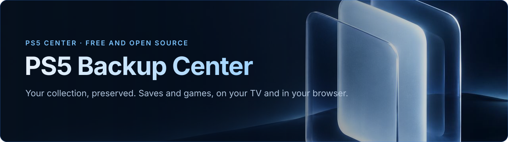
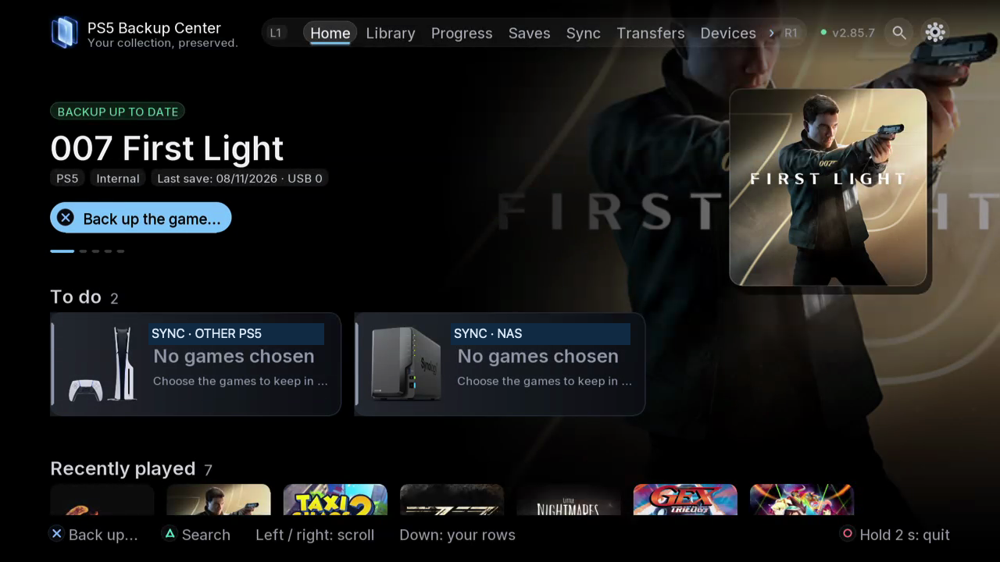

  

[English](../../README.md) · [Français](README.fr.md) · [Français (Canada)](README.fr-CA.md) · [Español](README.es.md) · [Español (Latinoamérica)](README.es-419.md) · [Português (Brasil)](README.pt-BR.md) · [Português (Portugal)](README.pt-PT.md) · [Deutsch](README.de.md) · [Italiano](README.it.md) · [Nederlands](README.nl.md) · [Polski](README.pl.md) · [Türkçe](README.tr.md) · [Русский](README.ru.md) · [简体中文](README.zh-Hans.md) · [繁體中文](README.zh-Hant.md) · [日本語](README.ja.md) · [한국어](README.ko.md) · [Tiếng Việt](README.vi.md) · [العربية](README.ar.md)

  

[Başlangıç](../guides/01-start.tr.md) · [Medya](../media.md)

# PS5 Backup Center

**Koleksiyonunuz. Oyun ilerlemeniz. Yedekleriniz.**

Nelerin yedeklenmesi gerektiğini görün, mevcut kopyaları karşılaştırın ve cihazlar arasındaki aktarımı düzenleyin. PS5 Backup Center envanteri, yedekleri, eşitlemeyi ve aktarımları TV’de ve tarayıcıda birleştirir.

**2.98.4 · GPL-3.0-or-later · 19 · 8**

Özgür yazılım. Abonelik yok.

## Neler yapabilirsiniz

- Oyunları, uygulamaları ve ROM’ları inceleyin; tüm içeriği, kayıtları, durumları veya desteklenen ayarları seçin.
- Saklanan kopyaları karşılaştırın, sürümleri yönetin ve isteğe bağlı döngülü planlar oluşturun.
- TV uygulaması kapandıktan sonra motor çalışırken görevleri tarayıcıdan izleyin.

## Kitaplık · Eşitleme

Saklanan yedekler ve etkin oyun kayıtları farklıdır. PS5’ler arasında veya NAS ile tutulacak kopyaları seçin. Yerel kullanıcı kimlikleri farklı olabilir: hedef hesap önemlidir. Switch ↔ Eden / ProsperoEden, Switch üzerinde JKSV ve ftpd kullanır. Uygulamalar ve ayarlar kendi kurallarına sahiptir. Tam oyunlar Aktarımlar bölümündedir.

## 2.98'deki yenilikler

- **Diğer PS5'in kütüphanesi**: oyunlarına, uygulamalarına ve kayıtlarına buradan göz atın (TV ve web) ve uzaktan yedekleyin.
- **Dosyalar**: bu PS5, USB, NAS, bir Switch ve diğer PS5 arasında her dosyayı kopyalayın, taşıyın veya silin; silme birkaç onay ister.
- **Oyun kaldırma**, burada ya da diğer PS5'te; kayıtlar önce yedeklenir.
- FTP/FTPS'nin yanında **SMB 2/3** (Windows, Synology, QNAP); **Églantine** (Switch 2); konsolu uygulamadan yeniden başlatma.
- Evden uzaktaki bir PS5 ile isteğe bağlı, şifreli **İnternet bağlantısı** (port 52373); yerel ağda port 52370.

## Kurulum

1. `PPSA99950.zip` dosyasını [son sürümden](https://github.com/consolecenterstudio/ps5-backup-center/releases/latest) indirin ve SHA-256 değerini doğrulayın (`SHA256SUMS`).
2. Arşivi açın ve `PPSA99950` klasörünü konsolda `/data/homebrew/` içine kopyalayın (FTP veya USB).
3. **PS5 Backup Center**'ı homebrew başlatıcınızdan açın: uygulama motorunu kendisi başlatır. İsteğe bağlı: sürümdeki `…-engine.elf` yalnızca motoru bir ELF yükleyiciden başlatır (port 9021).

Uygulama bu depodaki yeni sürümleri kendisi arar, Ana ekranda duyurur ve kurabilir; önceki sürüme dönmek mümkündür.

## TV / Web

- **Ana sayfa**
- **Kitaplık**
- **İlerleme**
- **Kayıtlar**
- **Eşitleme**
- **Aktarımlar**
- **Cihazlar**
- **Görevler**
- **Ayarlar**

## Ayarlar

19 dil ve sekiz temadan seçin. Sesler, arka plan müziği ve ses düzeyi ayrıdır. Eşleştirmeyi değiştirmeden kaynaklar, yok sayılanlar, kullanıcılar ve cihazları kontrol edin. Yeniliklerden değişiklikleri yeniden okuyabilirsiniz. Teşekkürlerde yazar, lisans ve kaynaklar bulunur.

## Diğer projeler

PS5 Center, kapsamı ve yol haritası birlikte geliştirilecek daha geniş bir gelecek projesidir; oyun ve uygulama yönetimiyle sınırlı değildir ve henüz geliştirilmemiştir. PS5 Connector, bağlayıcılar ve mevcut çözümlerle konsolların yeteneklerini genişletmeyi araştırır. NAS, paylaşımlar ve USB yalnızca örnektir. Prototip veya tarih duyurulmamıştır.

## Destekle

Yazılım ücretsiz sunulur. Bildirimler, çeviriler, belgelenmiş testler ve gönüllü destek; geliştirme, yapay zekâ araçları, test ve donanıma katkı sağlayabilir. Ödeme yolları ve herkese açık iletişim henüz belirlenmedi.

## Başlangıç

- [Başlangıç](../guides/01-start.tr.md)
- [Günlük yedekleme ve geri yükleme](../guides/02-everyday.tr.md)
- [Hedefler ve eşleştirilmiş konsollar](../guides/03-destinations.tr.md)
- [Oyunlar ve aktarımlar](../guides/04-transfers.tr.md)
- [Emülatörler ve ROM’lar](../guides/05-emulators.tr.md)
- [Ayarlar ve güncellemeler](../guides/06-settings.tr.md)
- [Sorun giderme](../guides/07-troubleshooting.tr.md)
- [Geliştiriciler için](../guides/08-developers.tr.md)
- [Proje ve destek](../guides/09-project.tr.md)
