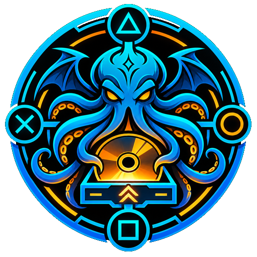

A PS5 game mounter. It finds games on the internal SSD, the M.2 drive and USB drives.

**Supported formats**: debug FPKG (`.pkg`) and game folders (plain, or packed with zstd or LZ4).
For large, demanding games, use the zstd pack format: it performs better than FPKG.

## How to

1. Download `kraken-mount.elf` from [Releases](https://github.com/quer3q/kraken-mount/releases)
   and send it to your jailbroken PS5 with the ELF loader (elfldr, port 9021) or payload-manager:
   `nc -w 3 <ps5-ip> 9021 < kraken-mount.elf`. kstuff must be loaded, and ShadowMount+ must not be
   running: Kraken Mount waits until both are true.
2. Put each game in a scan root:
   - internal SSD: `/data/homebrew`, `/data/etaHEN/games`
   - M.2 or extended drive (`/mnt/ext0`, `/mnt/ext1`): `homebrew`, `etaHEN/games` or the drive root
   - USB drive (`/mnt/usb0` to `/mnt/usb7`): `homebrew`, `etaHEN/games` or the drive root
3. Each game gets a "<name> registered" notification and its own home-screen tile.

[ampr-emu-ng](https://github.com/quer3q/ampr-emu-ng) comes bundled and is installed into
`/data/krakenmount/ampr/` at start. To run another build, put its `libSceAmpr.sprx` there; it is
kept until you delete it.

A game that needs the DLC or PlayGo emulator and ships none gets the bundled one in its fakelib
(setting `add_emulators`, on by default); a game's own copy is kept, unless it is a known older
release of the bundled one, which is upgraded. Details:
[DLC emulator](docs/dlcemu.md), [PlayGo stub](docs/playgo.md).

Caches live in `/data/krakenmount/caches/<TITLE_ID>`, settings in
`/data/krakenmount/config.toml` and the log in `/data/krakenmount/kraken.log`.

To build it yourself: `ps5/build.sh` (needs Docker), output `target/ps5/kraken-mount.elf`.

## Thanks

- [drakmor/ShadowMountPlus](https://github.com/drakmor/ShadowMountPlus): home-screen
  registration, the fakelib sandbox overlay and backports are ported from it.
- [drakmor/dlc_emu](https://github.com/drakmor/dlc_emu): the bundled DLC emulator
  (`libSceAppContent.sprx`, `libSceNpEntitlementAccess.sprx`, `libSceGameUpdate.sprx`), added to a
  game's fakelib when the game has a `dlc_emu.ini` at its root; a known older release the game ships
  is upgraded, any other copy is kept.
- [drakmor/pgo_stub](https://github.com/drakmor/pgo_stub): the bundled PlayGo stub
  (`libScePlayGo.sprx`), added to a game's fakelib when its `eboot.bin` imports `libScePlayGo` and the
  game ships none.
- [ps5-payload-sdk](https://github.com/ps5-payload-dev/sdk): the PS5 toolchain.

## License

GPL-3.0-or-later (`LICENSE`). Third-party notices are in `THIRD_PARTY_NOTICES`.
