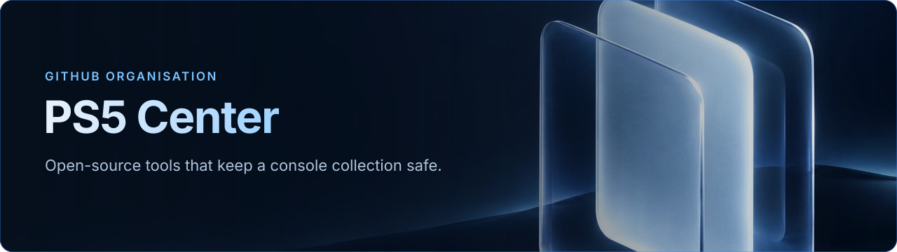

<!-- MOCK — profile of the GitHub organisation "PS5 Center" (repository ps5-center/.github, file profile/README.md). Nothing here is published. -->

  

  <b>Free, open-source tools for people who care about their game collection.</b> 
  One engine on the console. A TV app for the controller. The same interface on your phone.

  
  
  
  

---

### The apps

<table>
<tr>
<td width="50%" valign="top">

**[PS5 Backup Center](../ps5-backup-center/README.md)** &nbsp;`available · early access`

Back up, compare and restore PS5, PS4, Switch and emulator saves and games — to USB, to your NAS (FTP/FTPS), or to another console. Verified restores, content-aware duplicate detection, scheduled plans, full PS5 backup.

[README](../ps5-backup-center/README.md) · [Changelog](../ps5-backup-center/CHANGELOG.md) · [Français](../ps5-backup-center/README.fr.md)

</td>
<td width="50%" valign="top">

**PS5 Center** &nbsp;`planned`

Manage content and consoles: launch, install, move games between internal storage and USB, compress or decompress an installed game, then several PlayStations and console-to-console transfers. Its own safeguards: confirmation, free-space check, rollback, *back up first*.

</td>
</tr>
<tr>
<td valign="top">

**PS4 Center** &nbsp;`planned`

The same engine and protocol on a PS4: list, send and receive saves and backups with the other consoles on your network.

</td>
<td valign="top">

**Switch Center** &nbsp;`planned · agent`

A small agent on the Switch: discovered automatically, reads and writes saves directly (no JKSV step), shows profiles and free space. Until then, PS5 Backup Center reaches the Switch through ftpd + JKSV.

</td>
</tr>
<tr>
<td valign="top">

**NAS agents** &nbsp;`planned`

Packages for Synology DSM (ARM and x64) and standard Linux x64, so a NAS shows up on its own and serves as a fast, direct destination. Meanwhile, plain FTP/FTPS already works.

</td>
<td valign="top">

**One engine for all of them**

Scanner, disk index, task queue, connectors and web UI are written once. Each app is a face on it — so a destination added for one works for all.

</td>
</tr>
</table>

### What we stand for

- **Protect first.** Nothing is deleted or overwritten without your confirmation. Restores are verified. A running game is never touched.
- **Honest status.** *Available* means it runs on a real console today. *Planned* means not yet.
- **Credit everyone.** We build on Garlic, PS5 Game Compressor, the PS5 Payload SDK and more — every project, author and licence is listed in the app.
- **TV and web, together.** Every feature ships on both.

### Get involved

🐞 [Report a bug](../ps5-backup-center/.github/ISSUE_TEMPLATE/bug_report.yml) · 💡 [Suggest an idea](../ps5-backup-center/.github/ISSUE_TEMPLATE/feature_request.yml) · 🌍 Help translate (19 languages) · 📖 [Contributing guide](../ps5-backup-center/CONTRIBUTING.md)

☕ *Buy me a coffee* —  link coming soon.

Independent community project, not affiliated with Sony Interactive Entertainment or Nintendo. Trademarks belong to their owners.

🇫🇷 En français

**PS5 Center** réunit des outils libres et gratuits pour garder une collection de jeux à l'abri : un moteur sur la console, une app télé à la manette, la même interface sur le téléphone.

- **PS5 Backup Center** — *disponible, avant-première* : sauvegarder, comparer et restaurer les parties et les jeux PS5, PS4, Switch et émulateurs, vers l'USB, un NAS (FTP/FTPS) ou une autre console.
- **PS5 Center** — *prévu* : lancer, installer, déplacer et compresser les jeux, gérer plusieurs consoles.
- **PS4 Center**, **Switch Center**, **agents NAS** (Synology, Linux) — *prévus* : la même famille, qui se découvre toute seule sur le réseau.

Rien n'est effacé sans votre accord ; chaque projet utilisé est crédité dans l'app.

