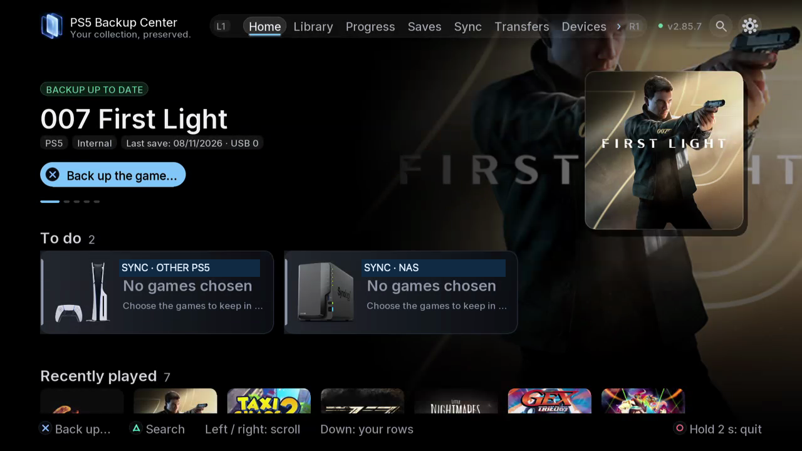
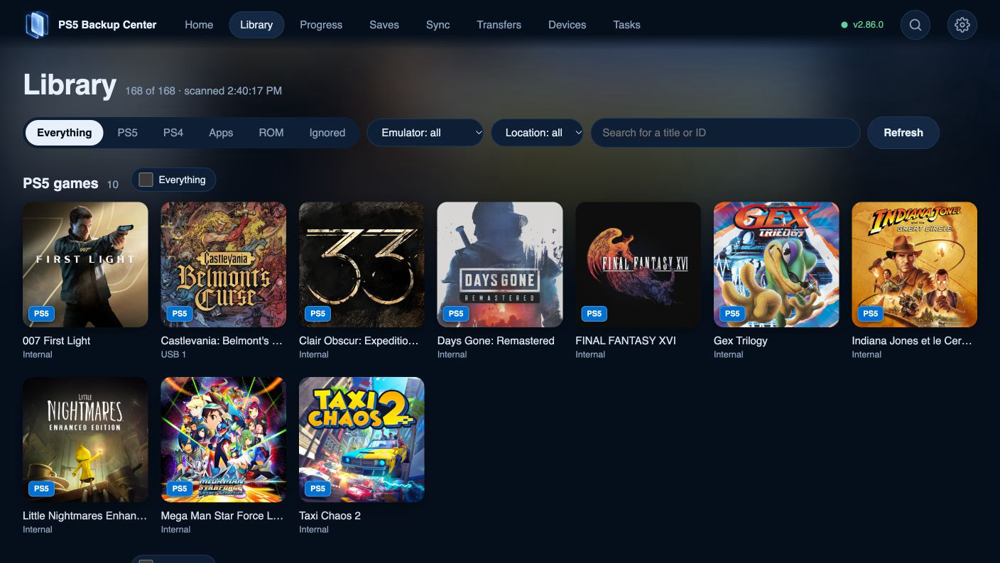

# Start here

Install, pair a browser and make your first stored copy.

## Where to find it

TV: Settings › Devices; Library. Use L1/R1 for tabs; open the gear for Settings.

Web: the corresponding spaces in the paired browser navigation; use buttons and checkboxes.

## Steps

1. Use a PS5 already configured for compatible native homebrew. Obtain the release package and compare its SHA-256 with the release checksum before installing. Public download and store links will accompany the release.
2. Launch PS5 Backup Center. Wait for the engine connection; continuing without it does not start backup work.

*Home separates your current game, actions to take and recently played titles. Scroll down for the other shelves.*

3. In Settings › Devices, read the web address shown by your console. Open it on your local network and enter the six-digit pairing code.

*In the paired browser, Library offers content, emulator and location filters.*

4. Open Library, choose a game, open its details and select its save component and a destination. Review the summary before confirming.
5. Open Tasks and check the result. Open Saves to find the dated copy.

## Safety and attention

Close the affected game or app before restoring, replacing or moving it. Check account, direction and destination; read confirmations and keep an independent copy of important data. Verification and safety copies reduce risk without providing an absolute guarantee.

[Use the web app and background engine](16-web-engine.md)
