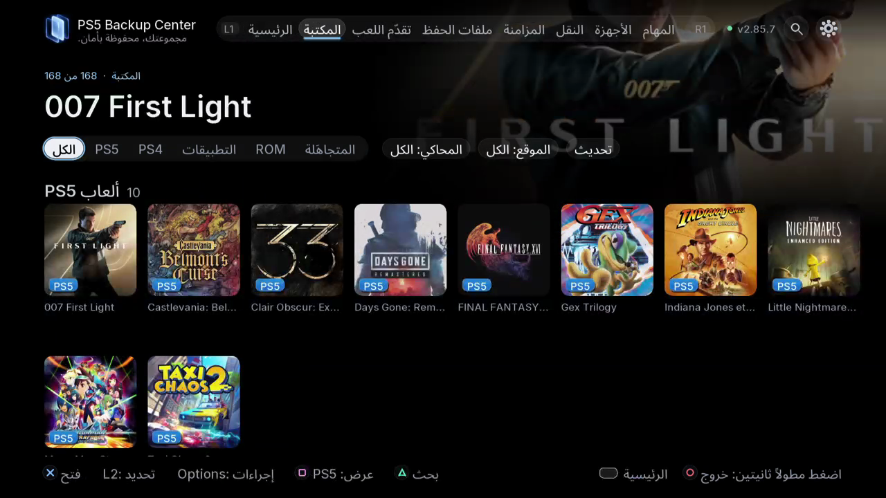

# النسخ والاستعادة اليومية

TV / Web: **المكتبة / تقدّم اللعب / ملفات الحفظ / المهام**.

النسخة المخزنة ليست ملف الحفظ النشط، ولا تتضمن اللعبة نفسها بالضرورة. اختر المكونات التي تريد حمايتها.

1. أغلق اللعبة. تحقق من اللاعب والعنوان وهوية قرص الوجهة والمساحة المتاحة.
2. افتح التفاصيل واختر الحفظ أو اللعبة أو المحتوى الإضافي أو الحالة أو الإعدادات من المكونات المتاحة. راجع الملخص قبل البدء.
3. تابع المهام حتى النتيجة النهائية. إرسال الطلب لا يعني اكتمال النسخ. اقرأ الأخطاء والعناصر التي تم تخطيها.
4. في النسخ الاحتياطية افتح إصدارات اللعبة وتحقق من تاريخ النسخة الجديدة ومكانها ومكوناتها.

تجعل الاستعادة النسخة المخزنة ملف الحفظ النشط للحساب المختار. لا تثبت اللعبة ولا تستعيد وحدة التحكم بالكامل.

إذا لم تكن النتيجة متوقعة فتوقف عن اللعب لتجنب حفظ تلقائي جديد. ابحث عن النسخة الآمنة والإصدار الأصلي قبل الاستعادة مجدداً. تكييف الحساب لا يحول ملفات الحفظ غير المتوافقة بين الألعاب أو المناطق أو الأجيال.

- [إنشاء نسخة احتياطية والتحقق منها](10-first-backup.ar.md)
- [مقارنة النسخ وتنظيف المكررات](11-compare-cleanup.ar.md)
- [استعادة ملف حفظ مختار](12-restore.ar.md)

*صفِّ حسب المحتوى والمحاكي والموقع قبل فتح تفاصيل اللعبة.*
