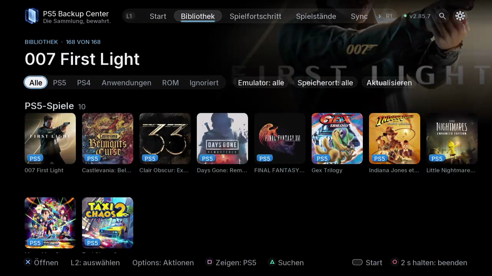

# Sichern und Wiederherstellen im Alltag

TV / Web: **Bibliothek / Spielfortschritt / Spielstände / Aufgaben**.

Eine gespeicherte Kopie ist nicht der aktive Spielstand und enthält nicht automatisch das Spiel. Wähle die zu sichernden Bestandteile ausdrücklich aus.

1. Schließe das Spiel. Prüfe Spieler, Titel, Identität des Ziellaufwerks und freien Speicher.
2. Öffne die Details und wähle Spielstand, Spiel, DLC, Zustand oder Konfiguration aus den angebotenen Bestandteilen. Prüfe die Zusammenfassung vor dem Start.
3. Verfolge Aufgaben bis zum endgültigen Ergebnis. Ein abgesendeter Auftrag ist noch keine abgeschlossene Sicherung. Lies Fehler und übersprungene Elemente.
4. Öffne unter Sicherungen die Versionen des Spiels. Prüfe Datum, Speicherort und Bestandteile der neuen Kopie.

Beim Wiederherstellen wird eine gespeicherte Kopie zum aktiven Spielstand des gewählten Kontos. Dies installiert weder das Spiel noch eine vollständige Konsolensicherung.

Spiele bei einem unerwarteten Ergebnis nicht weiter, damit keine neuen automatischen Speicherungen erfolgen. Suche Sicherheitskopie und Originalversion vor einer erneuten Wiederherstellung. Eine Kontoanpassung konvertiert keine inkompatiblen Spielstände zwischen Spielen, Regionen oder Generationen.

- [Eine Sicherung erstellen und prüfen](10-first-backup.de.md)
- [Kopien vergleichen und Duplikate bereinigen](11-compare-cleanup.de.md)
- [Einen ausgewählten Spielstand wiederherstellen](12-restore.de.md)

*Filtere nach Inhalt, Emulator und Speicherort, bevor du die Spieldetails öffnest.*
