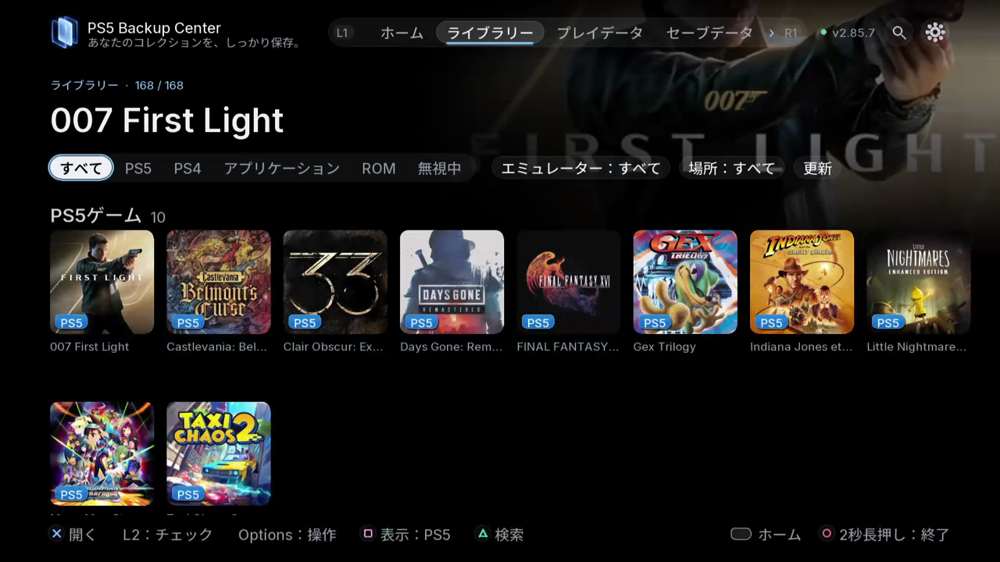

# 日常のバックアップと復元

TV / Web: **ライブラリー / プレイデータ / セーブデータ / タスク**.

保存したコピーはプレイに使う現在のセーブとは別物で、ゲーム本体が含まれるとは限りません。保護する項目を選んでください。

1. ゲームを終了し、プレイヤー、タイトル、保存先のディスクと空き容量を確認します。
2. 詳細を開き、表示された項目からセーブ、ゲーム、DLC、ステート、設定を選びます。開始前に概要を確認します。
3. タスクで最終結果まで確認します。依頼を送信しただけではバックアップ完了ではありません。エラーやスキップされた項目も読みます。
4. バックアップでゲームのバージョン一覧を開き、新しいコピーの日付、場所、内容を確認します。

復元は保存済みのコピーを選んだアカウントの現在の進行状況に戻します。ゲームのインストールや本体全体の復元とは異なります。

結果が予想と違う場合は、新しい自動セーブを避けるためプレイを止めます。再び復元する前に安全用コピーと元のバージョンを確認してください。アカウントの調整は、異なるゲーム、地域、世代の非互換セーブを変換するものではありません。

- [バックアップを作成して確認する](10-first-backup.ja.md)
- [コピーを比較して重複を整理する](11-compare-cleanup.ja.md)
- [選んだセーブを復元する](12-restore.ja.md)

*内容、エミュレーター、場所で絞り込んでからゲームの詳細を開きます。*
