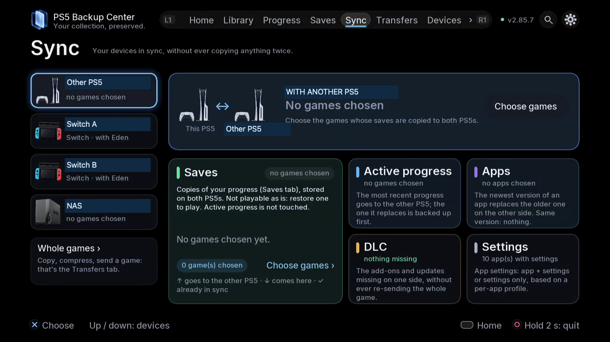

# Destinations and linked consoles

Choose storage and connect a second console or a Switch.

## Where to find it

TV: Devices; Sync. Use L1/R1 for tabs; open the gear for Settings.

Web: the corresponding spaces in the paired browser navigation; use buttons and checkboxes.

## Steps

1. For USB, select the identified disk and verify available space. Use its displayed identity rather than assuming its port number stays the same.
2. For a NAS, add the device, choose the supported connection type, enter its connection details, test, browse and select the destination folder before saving. FTP and FTPS are supported; SMB is being developed.
3. To link two PS5s, open Devices on both, select the discovered console or enter its address, then confirm the pairing code. Inspect the receiving console and disk before sending.
4. For Switch saves, start ftpd and prepare a JKSV export. Select the device and match the game and Eden / ProsperoEden profile. After sending back, follow the JKSV import instructions.
5. In Sync choose a device, then Saves, Active progress, Apps, DLC or Settings. Review direction and conflicts before confirming. Whole games opens Transfers. NAS depot mode concerns active progress and apps; DLC and settings are PS5-to-PS5.

*First choose the device at left, then the section. Saves are stored copies; Active progress is the save used to resume play. Whole games opens Transfers.*

## Safety and attention

Close the affected game or app before restoring, replacing or moving it. Check account, direction and destination; read confirmations and keep an independent copy of important data. Verification and safety copies reduce risk without providing an absolute guarantee.

## Detailed instructions

- [Choose the right sync workflow](13-sync.md)
