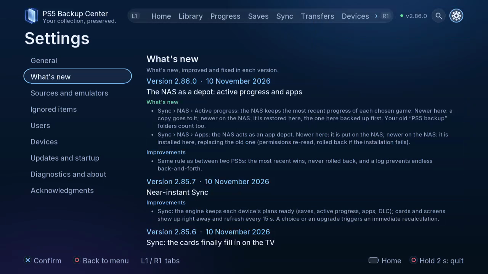

# Settings and updates

Personalise the interface and maintain the engine.

## Where to find it

TV: Settings. Use L1/R1 for tabs; open the gear for Settings.

Web: the corresponding spaces in the paired browser navigation; use buttons and checkboxes.

## Steps

1. In General choose among 19 languages and eight themes. Sound effects, background music and volume are separate controls.

2. Review Sources and emulators, Ignored items, Users and Devices. Linking account IDs affects identity matching: verify ownership before accepting.
3. In updates and startup, check the installed version and proposed update. Read What’s new before installation. Offline update discovery supports a PBC Update folder on USB.

*What’s new lets you reread version changes. This is the Settings page, not the installation confirmation.*

4. Allow the requested engine / app restart to finish. Check the resulting version and diagnostics if startup fails. Closing the TV app does not stop the background engine or its web interface.
5. Open Acknowledgements for component authors, licences and sources.

## Safety and attention

Close the affected game or app before restoring, replacing or moving it. Check account, direction and destination; read confirmations and keep an independent copy of important data. Verification and safety copies reduce risk without providing an absolute guarantee.

