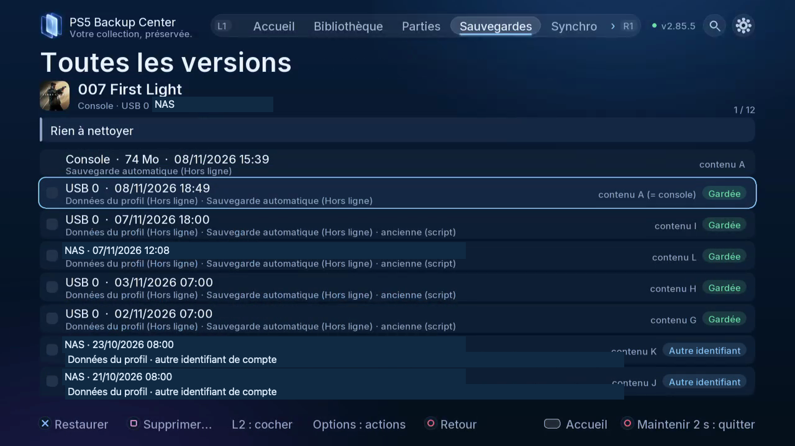

# Comparer les copies et nettoyer les doublons

## À quoi ça sert

Conserver les versions utiles sans multiplier les copies identiques sur le même stockage. Une empreinte de contenu identifie les données identiques ; la date ne suffit pas à reconnaître la partie la plus avancée.

*Les lettres distinguent les contenus ; vérifiez emplacement, compte et copies conservées avant nettoyage.*

## Où le trouver

Télé : **Sauvegardes**, le jeu, puis **Toutes les versions**. Web : **Sauvegardes**, le même jeu, puis ses versions. À la télé, L2 coche les copies et Options ouvre les actions ; sur le web, utilisez les cases et le menu d’actions.

## Lire la liste

- L’emplacement indique où la copie est rangée.
- Les lettres distinguent les contenus dans cette comparaison ; elles ne classent pas les parties de la meilleure à la moins bonne.
- Progression et temps de jeu dépendent de ce que le jeu enregistre et de ce qui peut être lu. Une valeur absente ne prouve pas une partie vide.
- Protection et compte doivent être vérifiés avant nettoyage. La copie d’un autre joueur n’est pas une version de secours de votre propre partie.

## Étapes

1. Ouvrez les versions et examinez tous les emplacements, jusqu’au bas de la liste.
2. Demandez la comparaison de contenu lorsqu’elle est proposée ; attendez sa fin avec le jeu fermé.
3. Distinguez doublons et progressions différentes. Choisissez ce que vous voulez conserver avant le nettoyage.
4. Protégez les versions importantes. Garder des versions récentes ne revient pas à conserver chaque parcours de jeu distinct.
5. Ouvrez la proposition de nettoyage et vérifiez chaque copie cochée : compte, stockage, protections et copies conservées.
6. Annulez si la proposition ne convient pas. Pour supprimer, lisez la confirmation et effectuez le maintien de cinq secondes demandé.
7. Revenez aux versions et examinez la corbeille là où elle est proposée. Vérifiez le délai affiché ; la corbeille locale utilise 30 jours. Ne supposez pas qu’une opération distante offre la même récupération.

## À éviter

Ne supprimez pas uniquement parce que deux copies portent la même heure. Conservez une copie indépendante de chaque progression importante. La corbeille des copies NAS est à venir : ne considérez pas une suppression NAS comme récupérable par la corbeille locale.

## Suite

[Restaurer une copie choisie](12-restore.fr.md)

[Retour aux guides](README.fr.md)
