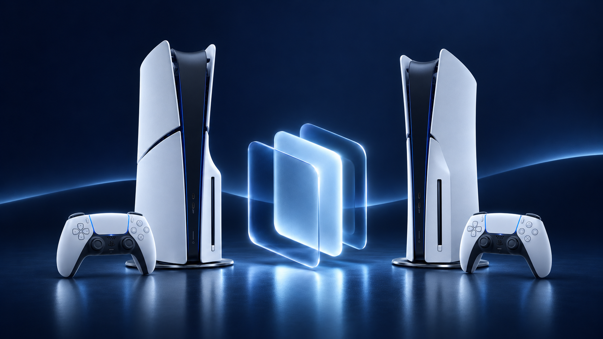

# Elegir el tipo de sincronización

Las copias almacenadas y las partidas activas son distintas. Los juegos completos se gestionan en transferencias. Un plan preparado rápidamente no significa sincronización automática continua.

## Dónde encontrarlo

TV / Web: **Sincro** → **Partidas guardadas / Progreso activo / Apps / DLC / Ajustes**.

## Pasos

1. Selecciona el dispositivo y la sección: copias, partidas activas, aplicaciones, ajustes o DLC. Empieza con una selección pequeña y explícita.
2. Para las copias, revisa juegos, versiones y destino. Para las partidas activas, comprueba las cuentas de ambos lados, el sentido y los conflictos; cierra el juego en ambas consolas.
3. Para aplicaciones, cierra la aplicación receptora y compara versión y huella. La misma versión con archivos diferentes requiere una decisión. Elige si incluir sus ajustes según el perfil disponible.
4. Revisa los cambios y confirma solo si coinciden con tu intención. Sigue la tarea hasta su resultado y actualiza la comparación antes de repetir.

## Más información

El NAS puede servir de depósito de partidas activas y aplicaciones; no ejecuta juegos. DLC y ajustes siguen siendo recorridos entre PS5. En Switch/Eden, comprueba juego y perfil, prepara JKSV y ftpd y completa la importación JKSV al devolver una partida. Switch ↔ Switch y la instalación de DLC PS5 están previstos; un inventario de paquetes no es una instalación.
