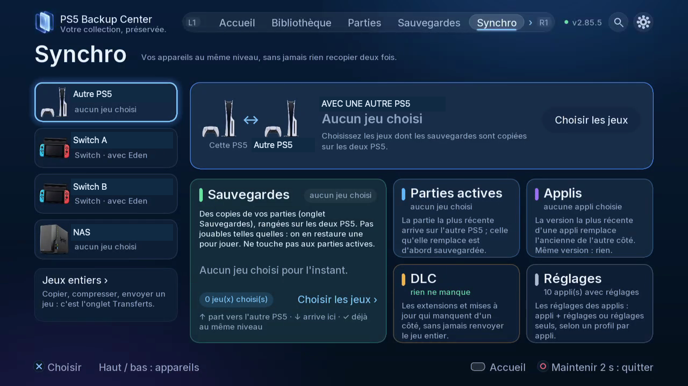

# Choisir le bon parcours de synchronisation

## Choisir ce qui doit être au même niveau

| Section | Contenu synchronisé | Points à vérifier |
|---|---|---|
| Sauvegardes | Copies rangées | Sélection, versions et disque destinataire |
| Parties actives | Parties utilisées pour reprendre le jeu | Comptes, sens et conflits |
| Applis | Versions des applications | Version, empreinte et application fermée |
| Réglages | Configuration selon le profil de l’application | Appli seule, avec réglages ou réglages seuls |
| DLC | Inventaire et transferts de composants pris en charge | Plateforme, jeu de base et opération proposée |

Les jeux entiers passent par **Transferts**. Conserver des copies sur deux appareils ne remplace pas automatiquement les parties jouables.

*Choisissez d’abord l’appareil, puis le contenu : copies, parties actives, applis, DLC ou réglages.*

## Où le trouver

Télé : **Synchro**, appareil à gauche, puis section. Web : **Synchro**, même appareil et même section. **Tâches** indique exécution et résultats.

## Deux PS5

1. Associez les consoles dans **Appareils**. Identifiez console locale et destinataire.
2. Ouvrez **Synchro**, sélectionnez l’autre PS5 puis une seule section. Commencez par une sélection explicite et limitée.
3. Pour les copies, examinez jeux, versions et option d’ajout des nouveaux jeux. Cette option de sélection ne constitue pas une synchronisation automatique sans intervention, qui reste à venir.
4. Pour les parties actives, vérifiez couple de comptes, sens, progression et temps de jeu. Fermez le jeu des deux côtés. Si les deux parties ont changé, choisissez celle voulue plutôt que de vous fier à la date seule.
5. Pour les applis, fermez l’application cible puis vérifiez versions et empreintes. Un même numéro avec des contenus différents demande une décision. Choisissez le périmètre de réglages proposé par le profil.
6. Lisez les changements, choisissez **Mettre à niveau** lorsque cela convient, puis suivez **Tâches**. Rouvrez la comparaison pour contrôler le nouvel état.

## Dépôt NAS

Choisissez le NAS dans **Synchro**. Copies, parties actives et applis restent distinctes. Pour les parties, le dépôt conserve la version qui permet de remettre les consoles au même niveau ; le NAS ne lance pas le jeu. Pour les applis, il conserve les versions à installer sur une console. Vérifiez le sens avant remplacement local. DLC et réglages d’applications restent des parcours entre PS5.

## Switch et Eden / ProsperoEden

Préparez les exports JKSV et démarrez ftpd sur la Switch. Ouvrez l’appareil Switch dans **Synchro**, vérifiez jeu et profil des deux côtés, puis comparaison et sens avant confirmation. Au retour sur la Switch, terminez les étapes d’import JKSV : copier un export ne suffit pas à remplacer la partie active. La synchro directe Switch ↔ Switch est à venir.

## DLC et paquets

Un inventaire ou un .pkg trouvé ne constitue pas une installation. Le transfert des DLC Switch entre PS5 concerne les fichiers pris en charge qui manquent dans le dossier du jeu de l’émulateur destinataire. Installation des DLC PS5 et passerelles Orbit / PatchDL restent à venir.

## Actualisation et reprise

Les plans préparés accélèrent l’affichage ; ils ne signifient pas une synchronisation continue automatique. Si l’appareil était hors ligne, reconnectez et actualisez avant d’accepter une ancienne proposition. Après interruption, examinez Tâches et la comparaison actualisée avant de relancer.

[Retour aux guides](README.fr.md)
