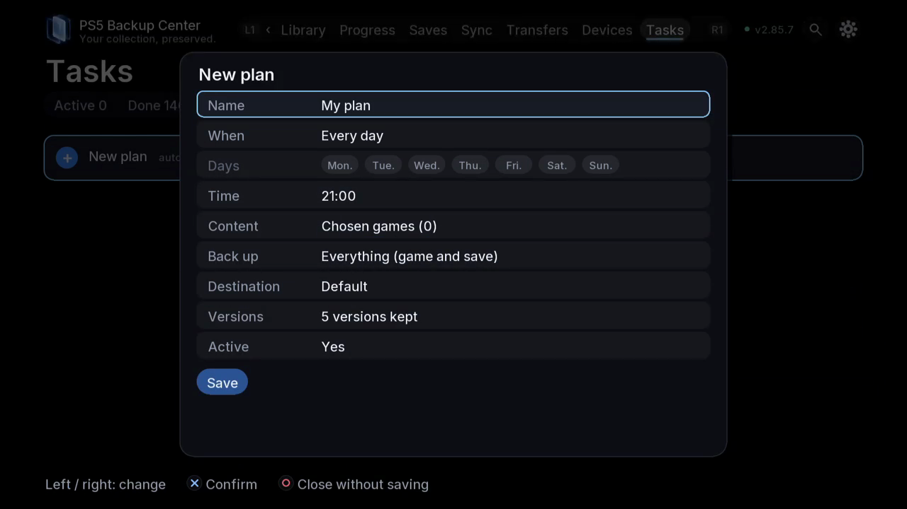

# Schedule a backup plan

## Purpose and access

Use a plan to repeat a selected backup without rebuilding its choices each time. TV and web: **Tasks**, open the plan editor; a game's details also offers **Scheduled plans…**. A recurring backup plan is distinct from the future automatic sync triggered by closing a game.

## Prepare the plan

1. Choose a preset if its scope matches your goal, or start a custom plan.
2. Give the plan a recognizable name. Choose individual games or the offered selection rules; review how new games are included.
3. Choose the components. A save-only plan does not protect the game files; an app-only plan does not necessarily contain its configuration.
4. Choose the destination and confirm the disk identity and free space. The destination must be accessible when the plan runs.
5. Choose on-demand, daily or the offered weekdays and time. Check the displayed schedule rather than assuming that closing the TV app stops it.
6. Set the number of versions to keep and review the retention scope. Rotation is not a substitute for an independent long-term copy.
7. Save the plan and reopen it to check the persisted choices. If appropriate, run it once on demand and inspect the actual task result.

## Follow and change it

Open Tasks to distinguish a saved plan from a queued, running, completed or failed execution. To change the scope, edit the plan, save and reopen it. Pause the plan before making destination changes if you do not want it to run meanwhile. Cancelling an execution and pausing a recurring plan are different decisions.

## Check the result

Inspect the task report and the expected versions in Saves. A plan appearing in the editor does not establish that a scheduled execution happened. If a destination was offline, read the error and existing queue before requesting a new run.

[Back to guides](README.md)

*Choose the schedule, components, destination and versions to keep before saving the plan.*
