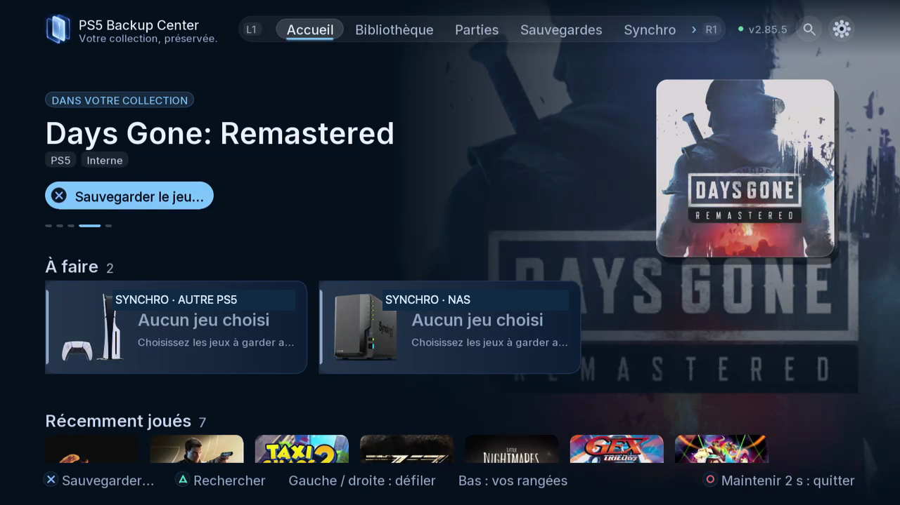

# Accueil et centre de notifications

L’Accueil transforme l’inventaire en actions utiles : jeux sans copie connue, copies plus récentes, doublons, contenus à comparer, éléments à vérifier, synchronisation des appareils et tâches en cours. Les cartes À faire apparaissent selon l’inventaire et l’état des appareils.

## Où le trouver

Télé : Accueil, descendez du jeu mis en avant vers **À faire**, puis les rangées. Web : Accueil, faites défiler les mêmes sections et ouvrez la carte concernée. La télé utilise la navigation à la manette ; le navigateur propose cartes et boutons.

## Lire la notification avant d’agir

| Carte ou état | Ce qu’il faut vérifier |
|---|---|
| À sauvegarder | Quel jeu et quelle partie de joueur n’ont pas de copie connue sur les stockages disponibles ? |
| Copie plus récente | Comparer contenu, progression et compte avant restauration. |
| Doublons | Examiner la proposition de nettoyage et les versions conservées. |
| Pas encore comparés | Demander ou attendre la comparaison ; les dates seules ne prouvent pas des doublons. |
| À vérifier | Examiner la copie et le problème signalé avant suppression ou remplacement. |
| Synchro · appareil | Vérifier jeux choisis, sens et conflits pour cet appareil. |
| Avancement d’une tâche | Lire opération, pourcentage et estimation, puis ouvrir Tâches pour le résultat. |

Couleurs de catégories et jaquettes distinguent les actions. Le compteur porte sur la sélection concernée : il ne promet pas que tous les jeux de tous les disques sont synchronisés. « Aucun jeu choisi » décrit une sélection, pas un échec. « Tout est au même niveau » concerne le périmètre choisi.

## Étapes

1. Examinez jeu mis en avant et cartes À faire avant de créer une nouvelle tâche.
2. Ouvrez la carte utile. Vérifiez jeu, joueur et stockage, sans vous fier au seul compteur.
3. Comparez ou choisissez le contenu voulu, lisez récapitulatif et confirmations puis lancez uniquement l’opération souhaitée.
4. Suivez Tâches jusqu’au résultat final. Revenez à l’Accueil et laissez l’inventaire et les notifications s’actualiser.
5. Descendez aussi vers jeux récents, contenus PS5/PS4, parties sans jeu installé, contenus disponibles ailleurs, plateformes rétro et applications. Les rangées dépendent de ce qui est trouvé.

## Choisir le bon espace

Bibliothèque répond à ce qui est disponible ; Parties présente les parties jouables par joueur ; Sauvegardes gère les copies rangées. Synchro remet les contenus choisis au même niveau entre appareils ; Transferts gère les jeux entiers ; Appareils configure destinations et consoles ; Tâches suit opérations et plans ; Paramètres regroupe langues, thèmes, sources, utilisateurs, mises à jour et crédits. L’Accueil relie ces espaces par les notifications ; ouvrir une carte ne prouve pas qu’une opération a fini.

*La zone À faire se trouve entre le jeu mis en avant et les rangées de contenu.*
